Analytathon 3
Energia Dataset


```python
import pandas as pd
import matplotlib.pyplot as plt
from datetime import time
import matplotlib.dates as mdates
import seaborn as sns
import numpy as np
from xgboost import XGBClassifier
from sklearn.model_selection import train_test_split
from sklearn.preprocessing import LabelEncoder
from sklearn.metrics import accuracy_score, precision_score
from sklearn.metrics import classification_report, confusion_matrix, ConfusionMatrixDisplay
import os
os.getcwd()


```


    'C:\\Users\\buedi\\Downloads\\DA_QUB\\Analytathon3'


```python


# Load the Excel file
xls = pd.ExcelFile("C:/Users/buedi/Downloads/DA_QUB/Analytathon3/QUB Data - Part 1.xlsx")

for sheet in xls.sheet_names:
    df = xls.parse(sheet)   
    df.to_csv(f"{sheet}.csv", index=False)

```


```python
print(xls.sheet_names)

```

    ['Wind', 'Demand', 'Actual Prices', 'Summary']
    


```python
Wind= pd.read_csv("Wind.csv")
Demand = pd.read_csv("Demand.csv")
Actual_Prices= pd.read_csv("Actual Prices.csv")

```


```python
Wind 

```


<div>
<style scoped>
    .dataframe tbody tr th:only-of-type {
        vertical-align: middle;
    }

    .dataframe tbody tr th {
        vertical-align: top;
    }

    .dataframe thead th {
        text-align: right;
    }
</style>
<table border="1" class="dataframe">
  <thead>
    <tr style="text-align: right;">
      <th></th>
      <th>Start Date</th>
      <th>Start Time 30 Minute Period</th>
      <th>Actual Wind (MW)</th>
      <th>DAM Forecast ISEMWIND</th>
      <th>IDA1 Forecast ISEMWIND</th>
      <th>IDA2 Forecast ISEMWIND</th>
      <th>IDA3 Forecast ISEMWIND</th>
    </tr>
  </thead>
  <tbody>
    <tr>
      <th>0</th>
      <td>31/03/2019</td>
      <td>23:00:00</td>
      <td>549</td>
      <td>404</td>
      <td>412</td>
      <td>NaN</td>
      <td>NaN</td>
    </tr>
    <tr>
      <th>1</th>
      <td>31/03/2019</td>
      <td>23:30:00</td>
      <td>558</td>
      <td>404</td>
      <td>412</td>
      <td>NaN</td>
      <td>NaN</td>
    </tr>
    <tr>
      <th>2</th>
      <td>01/04/2019</td>
      <td>00:00:00</td>
      <td>544</td>
      <td>380</td>
      <td>401</td>
      <td>NaN</td>
      <td>NaN</td>
    </tr>
    <tr>
      <th>3</th>
      <td>01/04/2019</td>
      <td>00:30:00</td>
      <td>492</td>
      <td>380</td>
      <td>401</td>
      <td>NaN</td>
      <td>NaN</td>
    </tr>
    <tr>
      <th>4</th>
      <td>01/04/2019</td>
      <td>01:00:00</td>
      <td>459</td>
      <td>366</td>
      <td>391</td>
      <td>NaN</td>
      <td>NaN</td>
    </tr>
    <tr>
      <th>...</th>
      <td>...</td>
      <td>...</td>
      <td>...</td>
      <td>...</td>
      <td>...</td>
      <td>...</td>
      <td>...</td>
    </tr>
    <tr>
      <th>8779</th>
      <td>30/09/2019</td>
      <td>20:30:00</td>
      <td>1530</td>
      <td>995</td>
      <td>1087</td>
      <td>1107.0</td>
      <td>1400.0</td>
    </tr>
    <tr>
      <th>8780</th>
      <td>30/09/2019</td>
      <td>21:00:00</td>
      <td>1499</td>
      <td>950</td>
      <td>1032</td>
      <td>1054.0</td>
      <td>1340.0</td>
    </tr>
    <tr>
      <th>8781</th>
      <td>30/09/2019</td>
      <td>21:30:00</td>
      <td>1390</td>
      <td>930</td>
      <td>987</td>
      <td>1003.0</td>
      <td>1284.0</td>
    </tr>
    <tr>
      <th>8782</th>
      <td>30/09/2019</td>
      <td>22:00:00</td>
      <td>1326</td>
      <td>915</td>
      <td>956</td>
      <td>969.0</td>
      <td>1232.0</td>
    </tr>
    <tr>
      <th>8783</th>
      <td>30/09/2019</td>
      <td>22:30:00</td>
      <td>1356</td>
      <td>905</td>
      <td>939</td>
      <td>951.0</td>
      <td>1187.0</td>
    </tr>
  </tbody>
</table>
<p>8784 rows × 7 columns</p>
</div>


```python
Demand 
```


<div>
<style scoped>
    .dataframe tbody tr th:only-of-type {
        vertical-align: middle;
    }

    .dataframe tbody tr th {
        vertical-align: top;
    }

    .dataframe thead th {
        text-align: right;
    }
</style>
<table border="1" class="dataframe">
  <thead>
    <tr style="text-align: right;">
      <th></th>
      <th>Start Date</th>
      <th>Start Time 30 Minute Period</th>
      <th>Actual Demand (MW)</th>
      <th>DAM Forecast ISEMDEMAND (FC at 10am D-1)</th>
      <th>IDA1 Forecast ISEMDEMAND</th>
      <th>IDA2 Forecast ISEMDEMAND</th>
      <th>IDA3 Forecast ISEMDEMAND</th>
    </tr>
  </thead>
  <tbody>
    <tr>
      <th>0</th>
      <td>31/03/2019</td>
      <td>23:00:00</td>
      <td>3714</td>
      <td>3713</td>
      <td>3712</td>
      <td>NaN</td>
      <td>NaN</td>
    </tr>
    <tr>
      <th>1</th>
      <td>31/03/2019</td>
      <td>23:30:00</td>
      <td>3504</td>
      <td>3713</td>
      <td>3712</td>
      <td>NaN</td>
      <td>NaN</td>
    </tr>
    <tr>
      <th>2</th>
      <td>01/04/2019</td>
      <td>00:00:00</td>
      <td>3427</td>
      <td>3456</td>
      <td>3456</td>
      <td>NaN</td>
      <td>NaN</td>
    </tr>
    <tr>
      <th>3</th>
      <td>01/04/2019</td>
      <td>00:30:00</td>
      <td>3362</td>
      <td>3456</td>
      <td>3456</td>
      <td>NaN</td>
      <td>NaN</td>
    </tr>
    <tr>
      <th>4</th>
      <td>01/04/2019</td>
      <td>01:00:00</td>
      <td>3267</td>
      <td>3237</td>
      <td>3234</td>
      <td>NaN</td>
      <td>NaN</td>
    </tr>
    <tr>
      <th>...</th>
      <td>...</td>
      <td>...</td>
      <td>...</td>
      <td>...</td>
      <td>...</td>
      <td>...</td>
      <td>...</td>
    </tr>
    <tr>
      <th>8779</th>
      <td>30/09/2019</td>
      <td>20:30:00</td>
      <td>4857</td>
      <td>4847</td>
      <td>4849</td>
      <td>4849.0</td>
      <td>4901.0</td>
    </tr>
    <tr>
      <th>8780</th>
      <td>30/09/2019</td>
      <td>21:00:00</td>
      <td>4687</td>
      <td>4657</td>
      <td>4658</td>
      <td>4658.0</td>
      <td>4717.0</td>
    </tr>
    <tr>
      <th>8781</th>
      <td>30/09/2019</td>
      <td>21:30:00</td>
      <td>4421</td>
      <td>4437</td>
      <td>4437</td>
      <td>4437.0</td>
      <td>4488.0</td>
    </tr>
    <tr>
      <th>8782</th>
      <td>30/09/2019</td>
      <td>22:00:00</td>
      <td>4181</td>
      <td>4189</td>
      <td>4190</td>
      <td>4190.0</td>
      <td>4216.0</td>
    </tr>
    <tr>
      <th>8783</th>
      <td>30/09/2019</td>
      <td>22:30:00</td>
      <td>3932</td>
      <td>3932</td>
      <td>3934</td>
      <td>3934.0</td>
      <td>3938.0</td>
    </tr>
  </tbody>
</table>
<p>8784 rows × 7 columns</p>
</div>


```python
Actual_Prices
```


<div>
<style scoped>
    .dataframe tbody tr th:only-of-type {
        vertical-align: middle;
    }

    .dataframe tbody tr th {
        vertical-align: top;
    }

    .dataframe thead th {
        text-align: right;
    }
</style>
<table border="1" class="dataframe">
  <thead>
    <tr style="text-align: right;">
      <th></th>
      <th>Start Date</th>
      <th>Time</th>
      <th>DA Price</th>
      <th>IDA1 Price</th>
      <th>IDA2 Price</th>
      <th>IDA3 Price</th>
      <th>BM Price</th>
    </tr>
  </thead>
  <tbody>
    <tr>
      <th>0</th>
      <td>31/03/2019</td>
      <td>23:00:00</td>
      <td>49.47</td>
      <td>53.600</td>
      <td>NaN</td>
      <td>NaN</td>
      <td>26.44</td>
    </tr>
    <tr>
      <th>1</th>
      <td>31/03/2019</td>
      <td>23:30:00</td>
      <td>49.47</td>
      <td>47.878</td>
      <td>NaN</td>
      <td>NaN</td>
      <td>39.25</td>
    </tr>
    <tr>
      <th>2</th>
      <td>01/04/2019</td>
      <td>00:00:00</td>
      <td>35.00</td>
      <td>44.000</td>
      <td>NaN</td>
      <td>NaN</td>
      <td>18.65</td>
    </tr>
    <tr>
      <th>3</th>
      <td>01/04/2019</td>
      <td>00:30:00</td>
      <td>35.00</td>
      <td>43.000</td>
      <td>NaN</td>
      <td>NaN</td>
      <td>27.91</td>
    </tr>
    <tr>
      <th>4</th>
      <td>01/04/2019</td>
      <td>01:00:00</td>
      <td>35.00</td>
      <td>43.000</td>
      <td>NaN</td>
      <td>NaN</td>
      <td>28.39</td>
    </tr>
    <tr>
      <th>...</th>
      <td>...</td>
      <td>...</td>
      <td>...</td>
      <td>...</td>
      <td>...</td>
      <td>...</td>
      <td>...</td>
    </tr>
    <tr>
      <th>8779</th>
      <td>30/09/2019</td>
      <td>20:30:00</td>
      <td>49.25</td>
      <td>45.990</td>
      <td>39.51</td>
      <td>29.0</td>
      <td>23.40</td>
    </tr>
    <tr>
      <th>8780</th>
      <td>30/09/2019</td>
      <td>21:00:00</td>
      <td>42.33</td>
      <td>47.260</td>
      <td>43.61</td>
      <td>36.0</td>
      <td>65.09</td>
    </tr>
    <tr>
      <th>8781</th>
      <td>30/09/2019</td>
      <td>21:30:00</td>
      <td>42.33</td>
      <td>40.290</td>
      <td>38.29</td>
      <td>28.1</td>
      <td>44.88</td>
    </tr>
    <tr>
      <th>8782</th>
      <td>30/09/2019</td>
      <td>22:00:00</td>
      <td>33.00</td>
      <td>38.400</td>
      <td>35.00</td>
      <td>27.0</td>
      <td>48.63</td>
    </tr>
    <tr>
      <th>8783</th>
      <td>30/09/2019</td>
      <td>22:30:00</td>
      <td>33.00</td>
      <td>26.720</td>
      <td>26.34</td>
      <td>24.0</td>
      <td>54.60</td>
    </tr>
  </tbody>
</table>
<p>8784 rows × 7 columns</p>
</div>


#Checking missing values per column for Wind Data frame
# total of 8784 rows and 7 columns 
# IDA2 and IDA3 have more missing values 


```python
print(Wind.isnull().sum())
```

    Start Date                        0
    Start Time 30 Minute Period       0
    Actual Wind (MW)                  0
    DAM Forecast ISEMWIND             0
    IDA1 Forecast ISEMWIND            0
    IDA2 Forecast ISEMWIND         4032
    IDA3 Forecast ISEMWIND         6588
    dtype: int64
    


```python
Wind.dtypes
```


    Start Date                      object
    Start Time 30 Minute Period     object
    Actual Wind (MW)                 int64
    DAM Forecast ISEMWIND            int64
    IDA1 Forecast ISEMWIND           int64
    IDA2 Forecast ISEMWIND         float64
    IDA3 Forecast ISEMWIND         float64
    dtype: object


```python
Wind.describe()
```


<div>
<style scoped>
    .dataframe tbody tr th:only-of-type {
        vertical-align: middle;
    }

    .dataframe tbody tr th {
        vertical-align: top;
    }

    .dataframe thead th {
        text-align: right;
    }
</style>
<table border="1" class="dataframe">
  <thead>
    <tr style="text-align: right;">
      <th></th>
      <th>Actual Wind (MW)</th>
      <th>DAM Forecast ISEMWIND</th>
      <th>IDA1 Forecast ISEMWIND</th>
      <th>IDA2 Forecast ISEMWIND</th>
      <th>IDA3 Forecast ISEMWIND</th>
    </tr>
  </thead>
  <tbody>
    <tr>
      <th>count</th>
      <td>8784.000000</td>
      <td>8784.000000</td>
      <td>8784.000000</td>
      <td>4752.000000</td>
      <td>2196.000000</td>
    </tr>
    <tr>
      <th>mean</th>
      <td>1094.201161</td>
      <td>1099.069786</td>
      <td>1102.157218</td>
      <td>1151.084806</td>
      <td>1127.933060</td>
    </tr>
    <tr>
      <th>std</th>
      <td>826.214675</td>
      <td>817.175630</td>
      <td>822.673426</td>
      <td>834.891238</td>
      <td>807.786326</td>
    </tr>
    <tr>
      <th>min</th>
      <td>0.000000</td>
      <td>24.000000</td>
      <td>27.000000</td>
      <td>30.000000</td>
      <td>44.000000</td>
    </tr>
    <tr>
      <th>25%</th>
      <td>368.750000</td>
      <td>398.000000</td>
      <td>394.000000</td>
      <td>440.750000</td>
      <td>447.000000</td>
    </tr>
    <tr>
      <th>50%</th>
      <td>912.000000</td>
      <td>922.000000</td>
      <td>943.000000</td>
      <td>982.000000</td>
      <td>981.000000</td>
    </tr>
    <tr>
      <th>75%</th>
      <td>1705.500000</td>
      <td>1647.250000</td>
      <td>1669.000000</td>
      <td>1705.250000</td>
      <td>1612.000000</td>
    </tr>
    <tr>
      <th>max</th>
      <td>3866.000000</td>
      <td>3538.000000</td>
      <td>3527.000000</td>
      <td>3482.000000</td>
      <td>3550.000000</td>
    </tr>
  </tbody>
</table>
</div>


```python
# Check for duplicates based on the Timestamp
print(Wind.index.duplicated().sum())

```

    0
    

# facet plot for all the main variables in Wind DF to understand the distribution


```python


columns = ['Actual Wind (MW)', 
             'DAM Forecast ISEMWIND', 
             'IDA1 Forecast ISEMWIND', 
             'IDA2 Forecast ISEMWIND', 
             'IDA3 Forecast ISEMWIND']
n_col = len(columns)

fig, axes = plt.subplots(nrows=3, ncols=2, figsize=(18, 10), sharex=True)
axes = axes.flatten()

for i, var in enumerate(columns):
    axes[i].plot(Wind.index, Wind[var])
    axes[i].set_title(var, fontsize=12)
    axes[i].grid(True)

for j in range(i+1, len(axes)):
    fig.delaxes(axes[j])

plt.tight_layout()
plt.show()

```


    
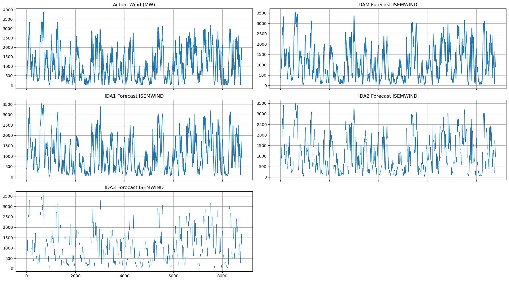
    


# checking why there is missing value in IDA2. Verifying if that is because of an auction gap or not by creationg flags  for reference.
#Auction Gap = Missing Forecast Value Where Auction Should Happen


```python

# Combine Start Date and Start Time into full timestamp and then Set that as the index
Wind['Timestamp'] = pd.to_datetime(Wind['Start Date'] + ' ' + Wind['Start Time 30 Minute Period'])


Wind.set_index('Timestamp', inplace=True)
```

    C:\Users\buedi\AppData\Local\Temp\ipykernel_33236\3171830991.py:2: UserWarning: Parsing dates in %d/%m/%Y %H:%M:%S format when dayfirst=False (the default) was specified. Pass `dayfirst=True` or specify a format to silence this warning.
      Wind['Timestamp'] = pd.to_datetime(Wind['Start Date'] + ' ' + Wind['Start Time 30 Minute Period'])
    


```python

Wind['Time'] = Wind.index.time ##Extract time  to filter IDA2 
Wind
```


<div>
<style scoped>
    .dataframe tbody tr th:only-of-type {
        vertical-align: middle;
    }

    .dataframe tbody tr th {
        vertical-align: top;
    }

    .dataframe thead th {
        text-align: right;
    }
</style>
<table border="1" class="dataframe">
  <thead>
    <tr style="text-align: right;">
      <th></th>
      <th>Start Date</th>
      <th>Start Time 30 Minute Period</th>
      <th>Actual Wind (MW)</th>
      <th>DAM Forecast ISEMWIND</th>
      <th>IDA1 Forecast ISEMWIND</th>
      <th>IDA2 Forecast ISEMWIND</th>
      <th>IDA3 Forecast ISEMWIND</th>
      <th>Time</th>
    </tr>
    <tr>
      <th>Timestamp</th>
      <th></th>
      <th></th>
      <th></th>
      <th></th>
      <th></th>
      <th></th>
      <th></th>
      <th></th>
    </tr>
  </thead>
  <tbody>
    <tr>
      <th>2019-03-31 23:00:00</th>
      <td>31/03/2019</td>
      <td>23:00:00</td>
      <td>549</td>
      <td>404</td>
      <td>412</td>
      <td>NaN</td>
      <td>NaN</td>
      <td>23:00:00</td>
    </tr>
    <tr>
      <th>2019-03-31 23:30:00</th>
      <td>31/03/2019</td>
      <td>23:30:00</td>
      <td>558</td>
      <td>404</td>
      <td>412</td>
      <td>NaN</td>
      <td>NaN</td>
      <td>23:30:00</td>
    </tr>
    <tr>
      <th>2019-04-01 00:00:00</th>
      <td>01/04/2019</td>
      <td>00:00:00</td>
      <td>544</td>
      <td>380</td>
      <td>401</td>
      <td>NaN</td>
      <td>NaN</td>
      <td>00:00:00</td>
    </tr>
    <tr>
      <th>2019-04-01 00:30:00</th>
      <td>01/04/2019</td>
      <td>00:30:00</td>
      <td>492</td>
      <td>380</td>
      <td>401</td>
      <td>NaN</td>
      <td>NaN</td>
      <td>00:30:00</td>
    </tr>
    <tr>
      <th>2019-04-01 01:00:00</th>
      <td>01/04/2019</td>
      <td>01:00:00</td>
      <td>459</td>
      <td>366</td>
      <td>391</td>
      <td>NaN</td>
      <td>NaN</td>
      <td>01:00:00</td>
    </tr>
    <tr>
      <th>...</th>
      <td>...</td>
      <td>...</td>
      <td>...</td>
      <td>...</td>
      <td>...</td>
      <td>...</td>
      <td>...</td>
      <td>...</td>
    </tr>
    <tr>
      <th>2019-09-30 20:30:00</th>
      <td>30/09/2019</td>
      <td>20:30:00</td>
      <td>1530</td>
      <td>995</td>
      <td>1087</td>
      <td>1107.0</td>
      <td>1400.0</td>
      <td>20:30:00</td>
    </tr>
    <tr>
      <th>2019-09-30 21:00:00</th>
      <td>30/09/2019</td>
      <td>21:00:00</td>
      <td>1499</td>
      <td>950</td>
      <td>1032</td>
      <td>1054.0</td>
      <td>1340.0</td>
      <td>21:00:00</td>
    </tr>
    <tr>
      <th>2019-09-30 21:30:00</th>
      <td>30/09/2019</td>
      <td>21:30:00</td>
      <td>1390</td>
      <td>930</td>
      <td>987</td>
      <td>1003.0</td>
      <td>1284.0</td>
      <td>21:30:00</td>
    </tr>
    <tr>
      <th>2019-09-30 22:00:00</th>
      <td>30/09/2019</td>
      <td>22:00:00</td>
      <td>1326</td>
      <td>915</td>
      <td>956</td>
      <td>969.0</td>
      <td>1232.0</td>
      <td>22:00:00</td>
    </tr>
    <tr>
      <th>2019-09-30 22:30:00</th>
      <td>30/09/2019</td>
      <td>22:30:00</td>
      <td>1356</td>
      <td>905</td>
      <td>939</td>
      <td>951.0</td>
      <td>1187.0</td>
      <td>22:30:00</td>
    </tr>
  </tbody>
</table>
<p>8784 rows × 8 columns</p>
</div>


# Filter values only between 11:00 and 23:00 (IDA2 auction window)
# Mark whether IDA2 forecast is available
# Extract missing entries (where auction didn't happen)


```python

ida2_wind_window = Wind[(Wind['Time'] >= time(11, 0)) & (Wind['Time'] < time(23, 0))].copy()


ida2_wind_window['IDA2_Available'] = ida2_wind_window['IDA2 Forecast ISEMWIND'].notnull().astype(int)


ida2_missing = ida2_wind_window[ida2_wind_window['IDA2_Available'] == 0].copy()

print("Total missing IDA2 forecasts during auction window:", len(ida2_missing))
```

    Total missing IDA2 forecasts during auction window: 0
    

#The IDA2 wind forecast was consistently available
# No auction failures happened during valid delivery periods
#All missing values (if any) were outside the auction window like nights or mornings
#Why 4392 Rows Show No Gaps?
#Filter applied  11:00 ≤ time < 23:00

#Each day contributes 24 half-hours × ~183 days = 4392 total

#All those rows have forecast values filled in = no missing data = no auction gaps

# Checking the same for IDA 3
# Filter values only between 17:00 and 23:00 (IDA3 auction window)
# Mark whether IDA3 forecast is available
# Extract missing entries (where auction didn't happen)
# Extract missing entries (where auction didn't happen)


```python

ida3_wind_window = Wind[(Wind['Time'] >= time(17, 0)) & (Wind['Time'] < time(23, 0))].copy()


ida3_wind_window['IDA3_Available'] = ida3_wind_window ['IDA3 Forecast ISEMWIND'].notnull().astype(int)


ida3_missing = ida3_wind_window[ida3_wind_window['IDA3_Available'] == 0].copy()
```


```python


ida3_missing = ida3_wind_window[ida3_wind_window['IDA3_Available'] == 0].copy()
print("Total missing IDA3 forecasts during auction window:", len(ida3_missing))
```

    Total missing IDA3 forecasts during auction window: 0
    


```python
#to Detect continuous auction gap blocks
#ida3_missing['time_diff'] = ida3_missing.index.to_series().diff()
#ida3_missing['gap_group'] = (ida3_missing['time_diff'] != pd.Timedelta(minutes=30)).cumsum()

```


```python
#Finally group the gap periods
#ida3_auction_gaps = ida3_missing.groupby('gap_group').agg(
 #   Start_Time=('Start Date', 'first'),
  #  End_Time=('Start Date', 'last'),
   # Duration_HalfHours=('Start Date', 'size')
#).reset_index(drop=True)

```


```python
# Print the auction gaps
#print("IDA3 Auction Gaps (from 17:00 To 23:00 only):")
#print(ida3_auction_gaps)
```

#Checking missing values per column for Demand Data frame
# total of 8784 rows and 7 columns 
# IDA2 and IDA3 have more missing values 
# its clear that there is connection between IDA2 values (# the count is same hence its not a error probably no auction happened at that time period)
# need further check.


```python
print(Demand.isnull().sum())

```

    Start Date                                     0
    Start Time 30 Minute Period                    0
    Actual Demand (MW)                             0
    DAM Forecast ISEMDEMAND (FC at 10am D-1)       0
    IDA1 Forecast ISEMDEMAND                       0
    IDA2 Forecast ISEMDEMAND                    4032
    IDA3 Forecast ISEMDEMAND                    6588
    dtype: int64
    


```python


# Combine Start Date and Start Time into full timestamp and then Set that as the index
Demand['Timestamp'] = pd.to_datetime(Demand['Start Date'] + ' ' + Demand['Start Time 30 Minute Period'])

Demand.set_index('Timestamp', inplace=True)

Demand['Time'] = Demand.index.time
```

    C:\Users\buedi\AppData\Local\Temp\ipykernel_33236\1810775754.py:2: UserWarning: Parsing dates in %d/%m/%Y %H:%M:%S format when dayfirst=False (the default) was specified. Pass `dayfirst=True` or specify a format to silence this warning.
      Demand['Timestamp'] = pd.to_datetime(Demand['Start Date'] + ' ' + Demand['Start Time 30 Minute Period'])
    


```python
# Filter values only between 11:00 and 23:00 (IDA2 demand auction window)
# Mark whether IDA2 demand forecast is available
# Extract missing entries (where auction didn't happen)
```


```python

ida2_demand_window = Demand[(Demand['Time'] >= time(11, 0)) & (Demand['Time'] < time(23, 0))].copy()

# Missing in valid auction window
print("Missing IDA2 during auction window:",ida2_demand_window['IDA2 Forecast ISEMDEMAND'].isnull().sum())
```

    Missing IDA2 during auction window: 0
    

#For IDA3 Demand forecast


```python
Demand['Time'] = Demand.index.time

ida3_demand_window = Demand[(Demand['Time'] >= time(17, 0)) & (Demand['Time'] < time(23, 0))].copy()
```


```python
ida3_demand_window['IDA3_Available'] = ida3_demand_window['IDA3 Forecast ISEMDEMAND'].notnull().astype(int)

```


```python
ida3_demand_missing = ida3_demand_window[ida3_demand_window['IDA3_Available'] == 0].copy()
print("Total missing IDA3 forecasts during auction window:", len(ida3_demand_missing))
```

    Total missing IDA3 forecasts during auction window: 0
    


```python
#ida3_demand_missing = ida3_demand_missing.sort_index()
#ida3_demand_missing['time_diff'] = ida3_demand_missing.index.to_series().diff()
#ida3_demand_missing['gap_group'] = ( ida3_demand_missing['time_diff'] != pd.Timedelta(minutes=30)).cumsum()
```


```python
#ida3_demand_gaps = ida3_demand_missing.groupby('gap_group').agg(
   # Start_Time=('Start Date', 'first'),
   # End_Time=('Start Date', 'last'),
    #Duration_HalfHours=('IDA3 Forecast ISEMDEMAND', 'size')
#).reset_index(drop=True)

#print(" IDA3 Demand Auction Gaps (17:00–23:00):")
#print(ida3_demand_gaps.head())
```

#Checking missing values per column for Demand Data frame
# total of 8784 rows and 7 columns 
# IDA2 and IDA3 have more missing values  as expected
# checked manually to identify if any acution was happening at the moment. Its evident from the given data there are no auctions during those periods .
#All those rows have forecast values filled in = no missing data = no auction gaps


```python

#facet plot for all the main variables in Demand DF to understand the distribution
```


```python


columns = [
    'Actual Demand (MW)',
    'DAM Forecast ISEMDEMAND (FC at 10am D-1)',
    'IDA1 Forecast ISEMDEMAND',
    'IDA2 Forecast ISEMDEMAND',
    'IDA3 Forecast ISEMDEMAND'
]

n_col = len(columns)

nrows = (n_col + 1) // 2  # Ceiling division
ncols = 2

fig, axes = plt.subplots(nrows=nrows, ncols=ncols, figsize=(18, nrows * 3.5), sharex=True)
axes = axes.flatten()

for i, var in enumerate(columns):
    axes[i].plot(Demand.index, Demand[var], label=var)
    axes[i].set_title(var, fontsize=12, fontweight='bold')
    axes[i].grid(True)
    axes[i].legend(loc='upper right', fontsize=9)


for j in range(n_col, len(axes)):
    fig.delaxes(axes[j])


plt.tight_layout()
plt.subplots_adjust(top=0.95)
fig.suptitle("Demand and Forecasts Over Time", fontsize=16, fontweight='bold')

plt.show()

```


    
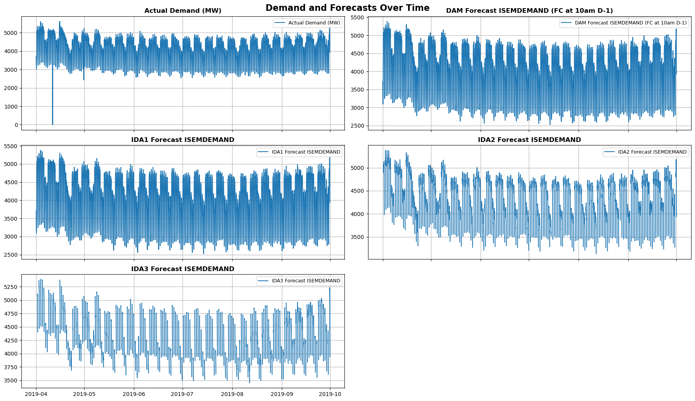
    


```python
print(Actual_Prices.isnull().sum())
Actual_Prices


```

    Start Date       0
    Time             0
    DA Price         0
    IDA1 Price       0
    IDA2 Price    4392
    IDA3 Price    6588
    BM Price         0
    dtype: int64
    


<div>
<style scoped>
    .dataframe tbody tr th:only-of-type {
        vertical-align: middle;
    }

    .dataframe tbody tr th {
        vertical-align: top;
    }

    .dataframe thead th {
        text-align: right;
    }
</style>
<table border="1" class="dataframe">
  <thead>
    <tr style="text-align: right;">
      <th></th>
      <th>Start Date</th>
      <th>Time</th>
      <th>DA Price</th>
      <th>IDA1 Price</th>
      <th>IDA2 Price</th>
      <th>IDA3 Price</th>
      <th>BM Price</th>
    </tr>
  </thead>
  <tbody>
    <tr>
      <th>0</th>
      <td>31/03/2019</td>
      <td>23:00:00</td>
      <td>49.47</td>
      <td>53.600</td>
      <td>NaN</td>
      <td>NaN</td>
      <td>26.44</td>
    </tr>
    <tr>
      <th>1</th>
      <td>31/03/2019</td>
      <td>23:30:00</td>
      <td>49.47</td>
      <td>47.878</td>
      <td>NaN</td>
      <td>NaN</td>
      <td>39.25</td>
    </tr>
    <tr>
      <th>2</th>
      <td>01/04/2019</td>
      <td>00:00:00</td>
      <td>35.00</td>
      <td>44.000</td>
      <td>NaN</td>
      <td>NaN</td>
      <td>18.65</td>
    </tr>
    <tr>
      <th>3</th>
      <td>01/04/2019</td>
      <td>00:30:00</td>
      <td>35.00</td>
      <td>43.000</td>
      <td>NaN</td>
      <td>NaN</td>
      <td>27.91</td>
    </tr>
    <tr>
      <th>4</th>
      <td>01/04/2019</td>
      <td>01:00:00</td>
      <td>35.00</td>
      <td>43.000</td>
      <td>NaN</td>
      <td>NaN</td>
      <td>28.39</td>
    </tr>
    <tr>
      <th>...</th>
      <td>...</td>
      <td>...</td>
      <td>...</td>
      <td>...</td>
      <td>...</td>
      <td>...</td>
      <td>...</td>
    </tr>
    <tr>
      <th>8779</th>
      <td>30/09/2019</td>
      <td>20:30:00</td>
      <td>49.25</td>
      <td>45.990</td>
      <td>39.51</td>
      <td>29.0</td>
      <td>23.40</td>
    </tr>
    <tr>
      <th>8780</th>
      <td>30/09/2019</td>
      <td>21:00:00</td>
      <td>42.33</td>
      <td>47.260</td>
      <td>43.61</td>
      <td>36.0</td>
      <td>65.09</td>
    </tr>
    <tr>
      <th>8781</th>
      <td>30/09/2019</td>
      <td>21:30:00</td>
      <td>42.33</td>
      <td>40.290</td>
      <td>38.29</td>
      <td>28.1</td>
      <td>44.88</td>
    </tr>
    <tr>
      <th>8782</th>
      <td>30/09/2019</td>
      <td>22:00:00</td>
      <td>33.00</td>
      <td>38.400</td>
      <td>35.00</td>
      <td>27.0</td>
      <td>48.63</td>
    </tr>
    <tr>
      <th>8783</th>
      <td>30/09/2019</td>
      <td>22:30:00</td>
      <td>33.00</td>
      <td>26.720</td>
      <td>26.34</td>
      <td>24.0</td>
      <td>54.60</td>
    </tr>
  </tbody>
</table>
<p>8784 rows × 7 columns</p>
</div>


```python

# Create full timestamp
Actual_Prices['Timestamp'] =  pd.to_datetime(Actual_Prices['Start Date'] + ' ' +Actual_Prices[ 'Time'])
Actual_Prices.set_index('Timestamp', inplace=True)
Actual_Prices['Time'] = Actual_Prices.index.time
```

    C:\Users\buedi\AppData\Local\Temp\ipykernel_33236\3816038752.py:2: UserWarning: Parsing dates in %d/%m/%Y %H:%M:%S format when dayfirst=False (the default) was specified. Pass `dayfirst=True` or specify a format to silence this warning.
      Actual_Prices['Timestamp'] =  pd.to_datetime(Actual_Prices['Start Date'] + ' ' +Actual_Prices[ 'Time'])
    


```python
# Filter values only between 11:00 and 23:00 (IDA2 price auction window)
# Mark whether IDA2  price forecast is available
# Extract missing entries (where auction didn't happe
```


```python

ida2_Price_window = Actual_Prices[(Actual_Prices['Time'] >= time(11, 0)) & (Actual_Prices['Time'] < time(23, 0))].copy()


ida2_Price_window['IDA2_Price_Available'] = ida2_Price_window['IDA2 Price'].notnull().astype(int)


ida2_Price_missing = ida2_Price_window[ida2_Price_window['IDA2_Price_Available'] == 0].copy()

print("Total missing IDA2 Price forecasts during auction window:", len(ida2_Price_missing))
```

    Total missing IDA2 Price forecasts during auction window: 0
    


```python
#for IDA3 Price # Filter values only between 17:00 and 23:00 (IDA3 auction window)
# Mark whether IDA3 forecast is available
# Extract missing entries (where auction didn't happen)
# Extract missing entries (where auction didn't happen)
```


```python

ida3_Price_window = Actual_Prices[(Actual_Prices['Time'] >= time(17, 0)) & (Actual_Prices['Time'] < time(23, 0))].copy()


ida3_Price_window['IDA3_Price_Available'] = ida3_Price_window ['IDA3 Price'].notnull().astype(int)


ida3_Price_missing = ida3_Price_window[ida3_Price_window['IDA3_Price_Available'] == 0].copy()
```


```python

ida3_Price_missing = ida3_Price_window[ida3_Price_window['IDA3_Price_Available'] == 0].copy()
print("Total missing IDA3 forecasts during auction window:", len(ida3_Price_missing))
```

    Total missing IDA3 forecasts during auction window: 0
    


```python
Actual_Prices
```


<div>
<style scoped>
    .dataframe tbody tr th:only-of-type {
        vertical-align: middle;
    }

    .dataframe tbody tr th {
        vertical-align: top;
    }

    .dataframe thead th {
        text-align: right;
    }
</style>
<table border="1" class="dataframe">
  <thead>
    <tr style="text-align: right;">
      <th></th>
      <th>Start Date</th>
      <th>Time</th>
      <th>DA Price</th>
      <th>IDA1 Price</th>
      <th>IDA2 Price</th>
      <th>IDA3 Price</th>
      <th>BM Price</th>
    </tr>
    <tr>
      <th>Timestamp</th>
      <th></th>
      <th></th>
      <th></th>
      <th></th>
      <th></th>
      <th></th>
      <th></th>
    </tr>
  </thead>
  <tbody>
    <tr>
      <th>2019-03-31 23:00:00</th>
      <td>31/03/2019</td>
      <td>23:00:00</td>
      <td>49.47</td>
      <td>53.600</td>
      <td>NaN</td>
      <td>NaN</td>
      <td>26.44</td>
    </tr>
    <tr>
      <th>2019-03-31 23:30:00</th>
      <td>31/03/2019</td>
      <td>23:30:00</td>
      <td>49.47</td>
      <td>47.878</td>
      <td>NaN</td>
      <td>NaN</td>
      <td>39.25</td>
    </tr>
    <tr>
      <th>2019-04-01 00:00:00</th>
      <td>01/04/2019</td>
      <td>00:00:00</td>
      <td>35.00</td>
      <td>44.000</td>
      <td>NaN</td>
      <td>NaN</td>
      <td>18.65</td>
    </tr>
    <tr>
      <th>2019-04-01 00:30:00</th>
      <td>01/04/2019</td>
      <td>00:30:00</td>
      <td>35.00</td>
      <td>43.000</td>
      <td>NaN</td>
      <td>NaN</td>
      <td>27.91</td>
    </tr>
    <tr>
      <th>2019-04-01 01:00:00</th>
      <td>01/04/2019</td>
      <td>01:00:00</td>
      <td>35.00</td>
      <td>43.000</td>
      <td>NaN</td>
      <td>NaN</td>
      <td>28.39</td>
    </tr>
    <tr>
      <th>...</th>
      <td>...</td>
      <td>...</td>
      <td>...</td>
      <td>...</td>
      <td>...</td>
      <td>...</td>
      <td>...</td>
    </tr>
    <tr>
      <th>2019-09-30 20:30:00</th>
      <td>30/09/2019</td>
      <td>20:30:00</td>
      <td>49.25</td>
      <td>45.990</td>
      <td>39.51</td>
      <td>29.0</td>
      <td>23.40</td>
    </tr>
    <tr>
      <th>2019-09-30 21:00:00</th>
      <td>30/09/2019</td>
      <td>21:00:00</td>
      <td>42.33</td>
      <td>47.260</td>
      <td>43.61</td>
      <td>36.0</td>
      <td>65.09</td>
    </tr>
    <tr>
      <th>2019-09-30 21:30:00</th>
      <td>30/09/2019</td>
      <td>21:30:00</td>
      <td>42.33</td>
      <td>40.290</td>
      <td>38.29</td>
      <td>28.1</td>
      <td>44.88</td>
    </tr>
    <tr>
      <th>2019-09-30 22:00:00</th>
      <td>30/09/2019</td>
      <td>22:00:00</td>
      <td>33.00</td>
      <td>38.400</td>
      <td>35.00</td>
      <td>27.0</td>
      <td>48.63</td>
    </tr>
    <tr>
      <th>2019-09-30 22:30:00</th>
      <td>30/09/2019</td>
      <td>22:30:00</td>
      <td>33.00</td>
      <td>26.720</td>
      <td>26.34</td>
      <td>24.0</td>
      <td>54.60</td>
    </tr>
  </tbody>
</table>
<p>8784 rows × 7 columns</p>
</div>


```python
Actual_Prices.columns = Actual_Prices.columns.str.strip()
```


#facet plot for all the main variables in Demand DF to understand the distribution


```python


# Ensure Start_Date is datetime
# mention all the required plots, and then facet plot
Actual_Prices['Start Date'] = pd.to_datetime(Actual_Prices['Start Date'])


price_cols = ['DA Price', 'IDA1 Price', 'IDA2 Price', 'IDA3 Price', 'BM Price']


fig, axes = plt.subplots(len(price_cols), 1, figsize=(14, 10), sharex=True)

for ax, col in zip(axes, price_cols):
    ax.plot(Actual_Prices['Start Date'], Actual_Prices[col])
    ax.set_title(col)
    ax.grid(True)
    ax.xaxis.set_major_formatter(mdates.DateFormatter('%b-%d'))
    ax.tick_params(axis='x', rotation=45)

plt.tight_layout()
plt.show()
```

    C:\Users\buedi\AppData\Local\Temp\ipykernel_33236\1611689211.py:3: UserWarning: Parsing dates in %d/%m/%Y format when dayfirst=False (the default) was specified. Pass `dayfirst=True` or specify a format to silence this warning.
      Actual_Prices['Start Date'] = pd.to_datetime(Actual_Prices['Start Date'])
    


    
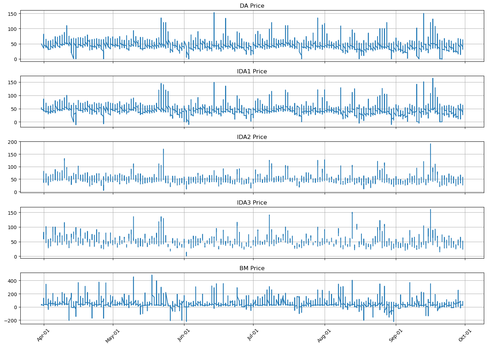
    


```python
#Replacing missing Values
```


```python
Wind_New= Wind.fillna(0)
Wind_New
```


<div>
<style scoped>
    .dataframe tbody tr th:only-of-type {
        vertical-align: middle;
    }

    .dataframe tbody tr th {
        vertical-align: top;
    }

    .dataframe thead th {
        text-align: right;
    }
</style>
<table border="1" class="dataframe">
  <thead>
    <tr style="text-align: right;">
      <th></th>
      <th>Start Date</th>
      <th>Start Time 30 Minute Period</th>
      <th>Actual Wind (MW)</th>
      <th>DAM Forecast ISEMWIND</th>
      <th>IDA1 Forecast ISEMWIND</th>
      <th>IDA2 Forecast ISEMWIND</th>
      <th>IDA3 Forecast ISEMWIND</th>
      <th>Time</th>
    </tr>
    <tr>
      <th>Timestamp</th>
      <th></th>
      <th></th>
      <th></th>
      <th></th>
      <th></th>
      <th></th>
      <th></th>
      <th></th>
    </tr>
  </thead>
  <tbody>
    <tr>
      <th>2019-03-31 23:00:00</th>
      <td>31/03/2019</td>
      <td>23:00:00</td>
      <td>549</td>
      <td>404</td>
      <td>412</td>
      <td>0.0</td>
      <td>0.0</td>
      <td>23:00:00</td>
    </tr>
    <tr>
      <th>2019-03-31 23:30:00</th>
      <td>31/03/2019</td>
      <td>23:30:00</td>
      <td>558</td>
      <td>404</td>
      <td>412</td>
      <td>0.0</td>
      <td>0.0</td>
      <td>23:30:00</td>
    </tr>
    <tr>
      <th>2019-04-01 00:00:00</th>
      <td>01/04/2019</td>
      <td>00:00:00</td>
      <td>544</td>
      <td>380</td>
      <td>401</td>
      <td>0.0</td>
      <td>0.0</td>
      <td>00:00:00</td>
    </tr>
    <tr>
      <th>2019-04-01 00:30:00</th>
      <td>01/04/2019</td>
      <td>00:30:00</td>
      <td>492</td>
      <td>380</td>
      <td>401</td>
      <td>0.0</td>
      <td>0.0</td>
      <td>00:30:00</td>
    </tr>
    <tr>
      <th>2019-04-01 01:00:00</th>
      <td>01/04/2019</td>
      <td>01:00:00</td>
      <td>459</td>
      <td>366</td>
      <td>391</td>
      <td>0.0</td>
      <td>0.0</td>
      <td>01:00:00</td>
    </tr>
    <tr>
      <th>...</th>
      <td>...</td>
      <td>...</td>
      <td>...</td>
      <td>...</td>
      <td>...</td>
      <td>...</td>
      <td>...</td>
      <td>...</td>
    </tr>
    <tr>
      <th>2019-09-30 20:30:00</th>
      <td>30/09/2019</td>
      <td>20:30:00</td>
      <td>1530</td>
      <td>995</td>
      <td>1087</td>
      <td>1107.0</td>
      <td>1400.0</td>
      <td>20:30:00</td>
    </tr>
    <tr>
      <th>2019-09-30 21:00:00</th>
      <td>30/09/2019</td>
      <td>21:00:00</td>
      <td>1499</td>
      <td>950</td>
      <td>1032</td>
      <td>1054.0</td>
      <td>1340.0</td>
      <td>21:00:00</td>
    </tr>
    <tr>
      <th>2019-09-30 21:30:00</th>
      <td>30/09/2019</td>
      <td>21:30:00</td>
      <td>1390</td>
      <td>930</td>
      <td>987</td>
      <td>1003.0</td>
      <td>1284.0</td>
      <td>21:30:00</td>
    </tr>
    <tr>
      <th>2019-09-30 22:00:00</th>
      <td>30/09/2019</td>
      <td>22:00:00</td>
      <td>1326</td>
      <td>915</td>
      <td>956</td>
      <td>969.0</td>
      <td>1232.0</td>
      <td>22:00:00</td>
    </tr>
    <tr>
      <th>2019-09-30 22:30:00</th>
      <td>30/09/2019</td>
      <td>22:30:00</td>
      <td>1356</td>
      <td>905</td>
      <td>939</td>
      <td>951.0</td>
      <td>1187.0</td>
      <td>22:30:00</td>
    </tr>
  </tbody>
</table>
<p>8784 rows × 8 columns</p>
</div>


```python
Demand_New= Demand.fillna(0)
Demand_New
```


<div>
<style scoped>
    .dataframe tbody tr th:only-of-type {
        vertical-align: middle;
    }

    .dataframe tbody tr th {
        vertical-align: top;
    }

    .dataframe thead th {
        text-align: right;
    }
</style>
<table border="1" class="dataframe">
  <thead>
    <tr style="text-align: right;">
      <th></th>
      <th>Start Date</th>
      <th>Start Time 30 Minute Period</th>
      <th>Actual Demand (MW)</th>
      <th>DAM Forecast ISEMDEMAND (FC at 10am D-1)</th>
      <th>IDA1 Forecast ISEMDEMAND</th>
      <th>IDA2 Forecast ISEMDEMAND</th>
      <th>IDA3 Forecast ISEMDEMAND</th>
      <th>Time</th>
    </tr>
    <tr>
      <th>Timestamp</th>
      <th></th>
      <th></th>
      <th></th>
      <th></th>
      <th></th>
      <th></th>
      <th></th>
      <th></th>
    </tr>
  </thead>
  <tbody>
    <tr>
      <th>2019-03-31 23:00:00</th>
      <td>31/03/2019</td>
      <td>23:00:00</td>
      <td>3714</td>
      <td>3713</td>
      <td>3712</td>
      <td>0.0</td>
      <td>0.0</td>
      <td>23:00:00</td>
    </tr>
    <tr>
      <th>2019-03-31 23:30:00</th>
      <td>31/03/2019</td>
      <td>23:30:00</td>
      <td>3504</td>
      <td>3713</td>
      <td>3712</td>
      <td>0.0</td>
      <td>0.0</td>
      <td>23:30:00</td>
    </tr>
    <tr>
      <th>2019-04-01 00:00:00</th>
      <td>01/04/2019</td>
      <td>00:00:00</td>
      <td>3427</td>
      <td>3456</td>
      <td>3456</td>
      <td>0.0</td>
      <td>0.0</td>
      <td>00:00:00</td>
    </tr>
    <tr>
      <th>2019-04-01 00:30:00</th>
      <td>01/04/2019</td>
      <td>00:30:00</td>
      <td>3362</td>
      <td>3456</td>
      <td>3456</td>
      <td>0.0</td>
      <td>0.0</td>
      <td>00:30:00</td>
    </tr>
    <tr>
      <th>2019-04-01 01:00:00</th>
      <td>01/04/2019</td>
      <td>01:00:00</td>
      <td>3267</td>
      <td>3237</td>
      <td>3234</td>
      <td>0.0</td>
      <td>0.0</td>
      <td>01:00:00</td>
    </tr>
    <tr>
      <th>...</th>
      <td>...</td>
      <td>...</td>
      <td>...</td>
      <td>...</td>
      <td>...</td>
      <td>...</td>
      <td>...</td>
      <td>...</td>
    </tr>
    <tr>
      <th>2019-09-30 20:30:00</th>
      <td>30/09/2019</td>
      <td>20:30:00</td>
      <td>4857</td>
      <td>4847</td>
      <td>4849</td>
      <td>4849.0</td>
      <td>4901.0</td>
      <td>20:30:00</td>
    </tr>
    <tr>
      <th>2019-09-30 21:00:00</th>
      <td>30/09/2019</td>
      <td>21:00:00</td>
      <td>4687</td>
      <td>4657</td>
      <td>4658</td>
      <td>4658.0</td>
      <td>4717.0</td>
      <td>21:00:00</td>
    </tr>
    <tr>
      <th>2019-09-30 21:30:00</th>
      <td>30/09/2019</td>
      <td>21:30:00</td>
      <td>4421</td>
      <td>4437</td>
      <td>4437</td>
      <td>4437.0</td>
      <td>4488.0</td>
      <td>21:30:00</td>
    </tr>
    <tr>
      <th>2019-09-30 22:00:00</th>
      <td>30/09/2019</td>
      <td>22:00:00</td>
      <td>4181</td>
      <td>4189</td>
      <td>4190</td>
      <td>4190.0</td>
      <td>4216.0</td>
      <td>22:00:00</td>
    </tr>
    <tr>
      <th>2019-09-30 22:30:00</th>
      <td>30/09/2019</td>
      <td>22:30:00</td>
      <td>3932</td>
      <td>3932</td>
      <td>3934</td>
      <td>3934.0</td>
      <td>3938.0</td>
      <td>22:30:00</td>
    </tr>
  </tbody>
</table>
<p>8784 rows × 8 columns</p>
</div>


```python
Actual_Prices_N = Actual_Prices.fillna(0)
Actual_Prices_N
```


<div>
<style scoped>
    .dataframe tbody tr th:only-of-type {
        vertical-align: middle;
    }

    .dataframe tbody tr th {
        vertical-align: top;
    }

    .dataframe thead th {
        text-align: right;
    }
</style>
<table border="1" class="dataframe">
  <thead>
    <tr style="text-align: right;">
      <th></th>
      <th>Start Date</th>
      <th>Time</th>
      <th>DA Price</th>
      <th>IDA1 Price</th>
      <th>IDA2 Price</th>
      <th>IDA3 Price</th>
      <th>BM Price</th>
    </tr>
    <tr>
      <th>Timestamp</th>
      <th></th>
      <th></th>
      <th></th>
      <th></th>
      <th></th>
      <th></th>
      <th></th>
    </tr>
  </thead>
  <tbody>
    <tr>
      <th>2019-03-31 23:00:00</th>
      <td>2019-03-31</td>
      <td>23:00:00</td>
      <td>49.47</td>
      <td>53.600</td>
      <td>0.00</td>
      <td>0.0</td>
      <td>26.44</td>
    </tr>
    <tr>
      <th>2019-03-31 23:30:00</th>
      <td>2019-03-31</td>
      <td>23:30:00</td>
      <td>49.47</td>
      <td>47.878</td>
      <td>0.00</td>
      <td>0.0</td>
      <td>39.25</td>
    </tr>
    <tr>
      <th>2019-04-01 00:00:00</th>
      <td>2019-04-01</td>
      <td>00:00:00</td>
      <td>35.00</td>
      <td>44.000</td>
      <td>0.00</td>
      <td>0.0</td>
      <td>18.65</td>
    </tr>
    <tr>
      <th>2019-04-01 00:30:00</th>
      <td>2019-04-01</td>
      <td>00:30:00</td>
      <td>35.00</td>
      <td>43.000</td>
      <td>0.00</td>
      <td>0.0</td>
      <td>27.91</td>
    </tr>
    <tr>
      <th>2019-04-01 01:00:00</th>
      <td>2019-04-01</td>
      <td>01:00:00</td>
      <td>35.00</td>
      <td>43.000</td>
      <td>0.00</td>
      <td>0.0</td>
      <td>28.39</td>
    </tr>
    <tr>
      <th>...</th>
      <td>...</td>
      <td>...</td>
      <td>...</td>
      <td>...</td>
      <td>...</td>
      <td>...</td>
      <td>...</td>
    </tr>
    <tr>
      <th>2019-09-30 20:30:00</th>
      <td>2019-09-30</td>
      <td>20:30:00</td>
      <td>49.25</td>
      <td>45.990</td>
      <td>39.51</td>
      <td>29.0</td>
      <td>23.40</td>
    </tr>
    <tr>
      <th>2019-09-30 21:00:00</th>
      <td>2019-09-30</td>
      <td>21:00:00</td>
      <td>42.33</td>
      <td>47.260</td>
      <td>43.61</td>
      <td>36.0</td>
      <td>65.09</td>
    </tr>
    <tr>
      <th>2019-09-30 21:30:00</th>
      <td>2019-09-30</td>
      <td>21:30:00</td>
      <td>42.33</td>
      <td>40.290</td>
      <td>38.29</td>
      <td>28.1</td>
      <td>44.88</td>
    </tr>
    <tr>
      <th>2019-09-30 22:00:00</th>
      <td>2019-09-30</td>
      <td>22:00:00</td>
      <td>33.00</td>
      <td>38.400</td>
      <td>35.00</td>
      <td>27.0</td>
      <td>48.63</td>
    </tr>
    <tr>
      <th>2019-09-30 22:30:00</th>
      <td>2019-09-30</td>
      <td>22:30:00</td>
      <td>33.00</td>
      <td>26.720</td>
      <td>26.34</td>
      <td>24.0</td>
      <td>54.60</td>
    </tr>
  </tbody>
</table>
<p>8784 rows × 7 columns</p>
</div>


```python
merged_df = Wind_New.merge(Demand_New, on='Timestamp', how='inner') \
               .merge(Actual_Prices_N, on='Timestamp', how='inner')
```


```python
merged_df# merged the new cleaned df
```


<div>
<style scoped>
    .dataframe tbody tr th:only-of-type {
        vertical-align: middle;
    }

    .dataframe tbody tr th {
        vertical-align: top;
    }

    .dataframe thead th {
        text-align: right;
    }
</style>
<table border="1" class="dataframe">
  <thead>
    <tr style="text-align: right;">
      <th></th>
      <th>Start Date_x</th>
      <th>Start Time 30 Minute Period_x</th>
      <th>Actual Wind (MW)</th>
      <th>DAM Forecast ISEMWIND</th>
      <th>IDA1 Forecast ISEMWIND</th>
      <th>IDA2 Forecast ISEMWIND</th>
      <th>IDA3 Forecast ISEMWIND</th>
      <th>Time_x</th>
      <th>Start Date_y</th>
      <th>Start Time 30 Minute Period_y</th>
      <th>...</th>
      <th>IDA2 Forecast ISEMDEMAND</th>
      <th>IDA3 Forecast ISEMDEMAND</th>
      <th>Time_y</th>
      <th>Start Date</th>
      <th>Time</th>
      <th>DA Price</th>
      <th>IDA1 Price</th>
      <th>IDA2 Price</th>
      <th>IDA3 Price</th>
      <th>BM Price</th>
    </tr>
    <tr>
      <th>Timestamp</th>
      <th></th>
      <th></th>
      <th></th>
      <th></th>
      <th></th>
      <th></th>
      <th></th>
      <th></th>
      <th></th>
      <th></th>
      <th></th>
      <th></th>
      <th></th>
      <th></th>
      <th></th>
      <th></th>
      <th></th>
      <th></th>
      <th></th>
      <th></th>
      <th></th>
    </tr>
  </thead>
  <tbody>
    <tr>
      <th>2019-03-31 23:00:00</th>
      <td>31/03/2019</td>
      <td>23:00:00</td>
      <td>549</td>
      <td>404</td>
      <td>412</td>
      <td>0.0</td>
      <td>0.0</td>
      <td>23:00:00</td>
      <td>31/03/2019</td>
      <td>23:00:00</td>
      <td>...</td>
      <td>0.0</td>
      <td>0.0</td>
      <td>23:00:00</td>
      <td>2019-03-31</td>
      <td>23:00:00</td>
      <td>49.47</td>
      <td>53.600</td>
      <td>0.00</td>
      <td>0.0</td>
      <td>26.44</td>
    </tr>
    <tr>
      <th>2019-03-31 23:30:00</th>
      <td>31/03/2019</td>
      <td>23:30:00</td>
      <td>558</td>
      <td>404</td>
      <td>412</td>
      <td>0.0</td>
      <td>0.0</td>
      <td>23:30:00</td>
      <td>31/03/2019</td>
      <td>23:30:00</td>
      <td>...</td>
      <td>0.0</td>
      <td>0.0</td>
      <td>23:30:00</td>
      <td>2019-03-31</td>
      <td>23:30:00</td>
      <td>49.47</td>
      <td>47.878</td>
      <td>0.00</td>
      <td>0.0</td>
      <td>39.25</td>
    </tr>
    <tr>
      <th>2019-04-01 00:00:00</th>
      <td>01/04/2019</td>
      <td>00:00:00</td>
      <td>544</td>
      <td>380</td>
      <td>401</td>
      <td>0.0</td>
      <td>0.0</td>
      <td>00:00:00</td>
      <td>01/04/2019</td>
      <td>00:00:00</td>
      <td>...</td>
      <td>0.0</td>
      <td>0.0</td>
      <td>00:00:00</td>
      <td>2019-04-01</td>
      <td>00:00:00</td>
      <td>35.00</td>
      <td>44.000</td>
      <td>0.00</td>
      <td>0.0</td>
      <td>18.65</td>
    </tr>
    <tr>
      <th>2019-04-01 00:30:00</th>
      <td>01/04/2019</td>
      <td>00:30:00</td>
      <td>492</td>
      <td>380</td>
      <td>401</td>
      <td>0.0</td>
      <td>0.0</td>
      <td>00:30:00</td>
      <td>01/04/2019</td>
      <td>00:30:00</td>
      <td>...</td>
      <td>0.0</td>
      <td>0.0</td>
      <td>00:30:00</td>
      <td>2019-04-01</td>
      <td>00:30:00</td>
      <td>35.00</td>
      <td>43.000</td>
      <td>0.00</td>
      <td>0.0</td>
      <td>27.91</td>
    </tr>
    <tr>
      <th>2019-04-01 01:00:00</th>
      <td>01/04/2019</td>
      <td>01:00:00</td>
      <td>459</td>
      <td>366</td>
      <td>391</td>
      <td>0.0</td>
      <td>0.0</td>
      <td>01:00:00</td>
      <td>01/04/2019</td>
      <td>01:00:00</td>
      <td>...</td>
      <td>0.0</td>
      <td>0.0</td>
      <td>01:00:00</td>
      <td>2019-04-01</td>
      <td>01:00:00</td>
      <td>35.00</td>
      <td>43.000</td>
      <td>0.00</td>
      <td>0.0</td>
      <td>28.39</td>
    </tr>
    <tr>
      <th>...</th>
      <td>...</td>
      <td>...</td>
      <td>...</td>
      <td>...</td>
      <td>...</td>
      <td>...</td>
      <td>...</td>
      <td>...</td>
      <td>...</td>
      <td>...</td>
      <td>...</td>
      <td>...</td>
      <td>...</td>
      <td>...</td>
      <td>...</td>
      <td>...</td>
      <td>...</td>
      <td>...</td>
      <td>...</td>
      <td>...</td>
      <td>...</td>
    </tr>
    <tr>
      <th>2019-09-30 20:30:00</th>
      <td>30/09/2019</td>
      <td>20:30:00</td>
      <td>1530</td>
      <td>995</td>
      <td>1087</td>
      <td>1107.0</td>
      <td>1400.0</td>
      <td>20:30:00</td>
      <td>30/09/2019</td>
      <td>20:30:00</td>
      <td>...</td>
      <td>4849.0</td>
      <td>4901.0</td>
      <td>20:30:00</td>
      <td>2019-09-30</td>
      <td>20:30:00</td>
      <td>49.25</td>
      <td>45.990</td>
      <td>39.51</td>
      <td>29.0</td>
      <td>23.40</td>
    </tr>
    <tr>
      <th>2019-09-30 21:00:00</th>
      <td>30/09/2019</td>
      <td>21:00:00</td>
      <td>1499</td>
      <td>950</td>
      <td>1032</td>
      <td>1054.0</td>
      <td>1340.0</td>
      <td>21:00:00</td>
      <td>30/09/2019</td>
      <td>21:00:00</td>
      <td>...</td>
      <td>4658.0</td>
      <td>4717.0</td>
      <td>21:00:00</td>
      <td>2019-09-30</td>
      <td>21:00:00</td>
      <td>42.33</td>
      <td>47.260</td>
      <td>43.61</td>
      <td>36.0</td>
      <td>65.09</td>
    </tr>
    <tr>
      <th>2019-09-30 21:30:00</th>
      <td>30/09/2019</td>
      <td>21:30:00</td>
      <td>1390</td>
      <td>930</td>
      <td>987</td>
      <td>1003.0</td>
      <td>1284.0</td>
      <td>21:30:00</td>
      <td>30/09/2019</td>
      <td>21:30:00</td>
      <td>...</td>
      <td>4437.0</td>
      <td>4488.0</td>
      <td>21:30:00</td>
      <td>2019-09-30</td>
      <td>21:30:00</td>
      <td>42.33</td>
      <td>40.290</td>
      <td>38.29</td>
      <td>28.1</td>
      <td>44.88</td>
    </tr>
    <tr>
      <th>2019-09-30 22:00:00</th>
      <td>30/09/2019</td>
      <td>22:00:00</td>
      <td>1326</td>
      <td>915</td>
      <td>956</td>
      <td>969.0</td>
      <td>1232.0</td>
      <td>22:00:00</td>
      <td>30/09/2019</td>
      <td>22:00:00</td>
      <td>...</td>
      <td>4190.0</td>
      <td>4216.0</td>
      <td>22:00:00</td>
      <td>2019-09-30</td>
      <td>22:00:00</td>
      <td>33.00</td>
      <td>38.400</td>
      <td>35.00</td>
      <td>27.0</td>
      <td>48.63</td>
    </tr>
    <tr>
      <th>2019-09-30 22:30:00</th>
      <td>30/09/2019</td>
      <td>22:30:00</td>
      <td>1356</td>
      <td>905</td>
      <td>939</td>
      <td>951.0</td>
      <td>1187.0</td>
      <td>22:30:00</td>
      <td>30/09/2019</td>
      <td>22:30:00</td>
      <td>...</td>
      <td>3934.0</td>
      <td>3938.0</td>
      <td>22:30:00</td>
      <td>2019-09-30</td>
      <td>22:30:00</td>
      <td>33.00</td>
      <td>26.720</td>
      <td>26.34</td>
      <td>24.0</td>
      <td>54.60</td>
    </tr>
  </tbody>
</table>
<p>8784 rows × 23 columns</p>
</div>


```python
merged_df.drop(columns=['Start Date_x',	'Start Time 30 Minute Period_x','Time_x','Start Date_y','Time_y'], inplace=True) # removing redundant variables
```


```python
merged_df.drop(columns=['Start Time 30 Minute Period_y'],inplace=True)

```


```python
merged_df
```


<div>
<style scoped>
    .dataframe tbody tr th:only-of-type {
        vertical-align: middle;
    }

    .dataframe tbody tr th {
        vertical-align: top;
    }

    .dataframe thead th {
        text-align: right;
    }
</style>
<table border="1" class="dataframe">
  <thead>
    <tr style="text-align: right;">
      <th></th>
      <th>Actual Wind (MW)</th>
      <th>DAM Forecast ISEMWIND</th>
      <th>IDA1 Forecast ISEMWIND</th>
      <th>IDA2 Forecast ISEMWIND</th>
      <th>IDA3 Forecast ISEMWIND</th>
      <th>Actual Demand (MW)</th>
      <th>DAM Forecast ISEMDEMAND (FC at 10am D-1)</th>
      <th>IDA1 Forecast ISEMDEMAND</th>
      <th>IDA2 Forecast ISEMDEMAND</th>
      <th>IDA3 Forecast ISEMDEMAND</th>
      <th>Start Date</th>
      <th>Time</th>
      <th>DA Price</th>
      <th>IDA1 Price</th>
      <th>IDA2 Price</th>
      <th>IDA3 Price</th>
      <th>BM Price</th>
    </tr>
    <tr>
      <th>Timestamp</th>
      <th></th>
      <th></th>
      <th></th>
      <th></th>
      <th></th>
      <th></th>
      <th></th>
      <th></th>
      <th></th>
      <th></th>
      <th></th>
      <th></th>
      <th></th>
      <th></th>
      <th></th>
      <th></th>
      <th></th>
    </tr>
  </thead>
  <tbody>
    <tr>
      <th>2019-03-31 23:00:00</th>
      <td>549</td>
      <td>404</td>
      <td>412</td>
      <td>0.0</td>
      <td>0.0</td>
      <td>3714</td>
      <td>3713</td>
      <td>3712</td>
      <td>0.0</td>
      <td>0.0</td>
      <td>2019-03-31</td>
      <td>23:00:00</td>
      <td>49.47</td>
      <td>53.600</td>
      <td>0.00</td>
      <td>0.0</td>
      <td>26.44</td>
    </tr>
    <tr>
      <th>2019-03-31 23:30:00</th>
      <td>558</td>
      <td>404</td>
      <td>412</td>
      <td>0.0</td>
      <td>0.0</td>
      <td>3504</td>
      <td>3713</td>
      <td>3712</td>
      <td>0.0</td>
      <td>0.0</td>
      <td>2019-03-31</td>
      <td>23:30:00</td>
      <td>49.47</td>
      <td>47.878</td>
      <td>0.00</td>
      <td>0.0</td>
      <td>39.25</td>
    </tr>
    <tr>
      <th>2019-04-01 00:00:00</th>
      <td>544</td>
      <td>380</td>
      <td>401</td>
      <td>0.0</td>
      <td>0.0</td>
      <td>3427</td>
      <td>3456</td>
      <td>3456</td>
      <td>0.0</td>
      <td>0.0</td>
      <td>2019-04-01</td>
      <td>00:00:00</td>
      <td>35.00</td>
      <td>44.000</td>
      <td>0.00</td>
      <td>0.0</td>
      <td>18.65</td>
    </tr>
    <tr>
      <th>2019-04-01 00:30:00</th>
      <td>492</td>
      <td>380</td>
      <td>401</td>
      <td>0.0</td>
      <td>0.0</td>
      <td>3362</td>
      <td>3456</td>
      <td>3456</td>
      <td>0.0</td>
      <td>0.0</td>
      <td>2019-04-01</td>
      <td>00:30:00</td>
      <td>35.00</td>
      <td>43.000</td>
      <td>0.00</td>
      <td>0.0</td>
      <td>27.91</td>
    </tr>
    <tr>
      <th>2019-04-01 01:00:00</th>
      <td>459</td>
      <td>366</td>
      <td>391</td>
      <td>0.0</td>
      <td>0.0</td>
      <td>3267</td>
      <td>3237</td>
      <td>3234</td>
      <td>0.0</td>
      <td>0.0</td>
      <td>2019-04-01</td>
      <td>01:00:00</td>
      <td>35.00</td>
      <td>43.000</td>
      <td>0.00</td>
      <td>0.0</td>
      <td>28.39</td>
    </tr>
    <tr>
      <th>...</th>
      <td>...</td>
      <td>...</td>
      <td>...</td>
      <td>...</td>
      <td>...</td>
      <td>...</td>
      <td>...</td>
      <td>...</td>
      <td>...</td>
      <td>...</td>
      <td>...</td>
      <td>...</td>
      <td>...</td>
      <td>...</td>
      <td>...</td>
      <td>...</td>
      <td>...</td>
    </tr>
    <tr>
      <th>2019-09-30 20:30:00</th>
      <td>1530</td>
      <td>995</td>
      <td>1087</td>
      <td>1107.0</td>
      <td>1400.0</td>
      <td>4857</td>
      <td>4847</td>
      <td>4849</td>
      <td>4849.0</td>
      <td>4901.0</td>
      <td>2019-09-30</td>
      <td>20:30:00</td>
      <td>49.25</td>
      <td>45.990</td>
      <td>39.51</td>
      <td>29.0</td>
      <td>23.40</td>
    </tr>
    <tr>
      <th>2019-09-30 21:00:00</th>
      <td>1499</td>
      <td>950</td>
      <td>1032</td>
      <td>1054.0</td>
      <td>1340.0</td>
      <td>4687</td>
      <td>4657</td>
      <td>4658</td>
      <td>4658.0</td>
      <td>4717.0</td>
      <td>2019-09-30</td>
      <td>21:00:00</td>
      <td>42.33</td>
      <td>47.260</td>
      <td>43.61</td>
      <td>36.0</td>
      <td>65.09</td>
    </tr>
    <tr>
      <th>2019-09-30 21:30:00</th>
      <td>1390</td>
      <td>930</td>
      <td>987</td>
      <td>1003.0</td>
      <td>1284.0</td>
      <td>4421</td>
      <td>4437</td>
      <td>4437</td>
      <td>4437.0</td>
      <td>4488.0</td>
      <td>2019-09-30</td>
      <td>21:30:00</td>
      <td>42.33</td>
      <td>40.290</td>
      <td>38.29</td>
      <td>28.1</td>
      <td>44.88</td>
    </tr>
    <tr>
      <th>2019-09-30 22:00:00</th>
      <td>1326</td>
      <td>915</td>
      <td>956</td>
      <td>969.0</td>
      <td>1232.0</td>
      <td>4181</td>
      <td>4189</td>
      <td>4190</td>
      <td>4190.0</td>
      <td>4216.0</td>
      <td>2019-09-30</td>
      <td>22:00:00</td>
      <td>33.00</td>
      <td>38.400</td>
      <td>35.00</td>
      <td>27.0</td>
      <td>48.63</td>
    </tr>
    <tr>
      <th>2019-09-30 22:30:00</th>
      <td>1356</td>
      <td>905</td>
      <td>939</td>
      <td>951.0</td>
      <td>1187.0</td>
      <td>3932</td>
      <td>3932</td>
      <td>3934</td>
      <td>3934.0</td>
      <td>3938.0</td>
      <td>2019-09-30</td>
      <td>22:30:00</td>
      <td>33.00</td>
      <td>26.720</td>
      <td>26.34</td>
      <td>24.0</td>
      <td>54.60</td>
    </tr>
  </tbody>
</table>
<p>8784 rows × 17 columns</p>
</div>


```python
merged_df.to_csv('merged_data.csv', index=True)

```


```python
df= pd.read_csv("merged_data.csv")
df
```


<div>
<style scoped>
    .dataframe tbody tr th:only-of-type {
        vertical-align: middle;
    }

    .dataframe tbody tr th {
        vertical-align: top;
    }

    .dataframe thead th {
        text-align: right;
    }
</style>
<table border="1" class="dataframe">
  <thead>
    <tr style="text-align: right;">
      <th></th>
      <th>Timestamp</th>
      <th>Actual Wind (MW)</th>
      <th>DAM Forecast ISEMWIND</th>
      <th>IDA1 Forecast ISEMWIND</th>
      <th>IDA2 Forecast ISEMWIND</th>
      <th>IDA3 Forecast ISEMWIND</th>
      <th>Actual Demand (MW)</th>
      <th>DAM Forecast ISEMDEMAND (FC at 10am D-1)</th>
      <th>IDA1 Forecast ISEMDEMAND</th>
      <th>IDA2 Forecast ISEMDEMAND</th>
      <th>IDA3 Forecast ISEMDEMAND</th>
      <th>Start Date</th>
      <th>Time</th>
      <th>DA Price</th>
      <th>IDA1 Price</th>
      <th>IDA2 Price</th>
      <th>IDA3 Price</th>
      <th>BM Price</th>
    </tr>
  </thead>
  <tbody>
    <tr>
      <th>0</th>
      <td>2019-03-31 23:00:00</td>
      <td>549</td>
      <td>404</td>
      <td>412</td>
      <td>0.0</td>
      <td>0.0</td>
      <td>3714</td>
      <td>3713</td>
      <td>3712</td>
      <td>0.0</td>
      <td>0.0</td>
      <td>2019-03-31</td>
      <td>23:00:00</td>
      <td>49.47</td>
      <td>53.600</td>
      <td>0.00</td>
      <td>0.0</td>
      <td>26.44</td>
    </tr>
    <tr>
      <th>1</th>
      <td>2019-03-31 23:30:00</td>
      <td>558</td>
      <td>404</td>
      <td>412</td>
      <td>0.0</td>
      <td>0.0</td>
      <td>3504</td>
      <td>3713</td>
      <td>3712</td>
      <td>0.0</td>
      <td>0.0</td>
      <td>2019-03-31</td>
      <td>23:30:00</td>
      <td>49.47</td>
      <td>47.878</td>
      <td>0.00</td>
      <td>0.0</td>
      <td>39.25</td>
    </tr>
    <tr>
      <th>2</th>
      <td>2019-04-01 00:00:00</td>
      <td>544</td>
      <td>380</td>
      <td>401</td>
      <td>0.0</td>
      <td>0.0</td>
      <td>3427</td>
      <td>3456</td>
      <td>3456</td>
      <td>0.0</td>
      <td>0.0</td>
      <td>2019-04-01</td>
      <td>00:00:00</td>
      <td>35.00</td>
      <td>44.000</td>
      <td>0.00</td>
      <td>0.0</td>
      <td>18.65</td>
    </tr>
    <tr>
      <th>3</th>
      <td>2019-04-01 00:30:00</td>
      <td>492</td>
      <td>380</td>
      <td>401</td>
      <td>0.0</td>
      <td>0.0</td>
      <td>3362</td>
      <td>3456</td>
      <td>3456</td>
      <td>0.0</td>
      <td>0.0</td>
      <td>2019-04-01</td>
      <td>00:30:00</td>
      <td>35.00</td>
      <td>43.000</td>
      <td>0.00</td>
      <td>0.0</td>
      <td>27.91</td>
    </tr>
    <tr>
      <th>4</th>
      <td>2019-04-01 01:00:00</td>
      <td>459</td>
      <td>366</td>
      <td>391</td>
      <td>0.0</td>
      <td>0.0</td>
      <td>3267</td>
      <td>3237</td>
      <td>3234</td>
      <td>0.0</td>
      <td>0.0</td>
      <td>2019-04-01</td>
      <td>01:00:00</td>
      <td>35.00</td>
      <td>43.000</td>
      <td>0.00</td>
      <td>0.0</td>
      <td>28.39</td>
    </tr>
    <tr>
      <th>...</th>
      <td>...</td>
      <td>...</td>
      <td>...</td>
      <td>...</td>
      <td>...</td>
      <td>...</td>
      <td>...</td>
      <td>...</td>
      <td>...</td>
      <td>...</td>
      <td>...</td>
      <td>...</td>
      <td>...</td>
      <td>...</td>
      <td>...</td>
      <td>...</td>
      <td>...</td>
      <td>...</td>
    </tr>
    <tr>
      <th>8779</th>
      <td>2019-09-30 20:30:00</td>
      <td>1530</td>
      <td>995</td>
      <td>1087</td>
      <td>1107.0</td>
      <td>1400.0</td>
      <td>4857</td>
      <td>4847</td>
      <td>4849</td>
      <td>4849.0</td>
      <td>4901.0</td>
      <td>2019-09-30</td>
      <td>20:30:00</td>
      <td>49.25</td>
      <td>45.990</td>
      <td>39.51</td>
      <td>29.0</td>
      <td>23.40</td>
    </tr>
    <tr>
      <th>8780</th>
      <td>2019-09-30 21:00:00</td>
      <td>1499</td>
      <td>950</td>
      <td>1032</td>
      <td>1054.0</td>
      <td>1340.0</td>
      <td>4687</td>
      <td>4657</td>
      <td>4658</td>
      <td>4658.0</td>
      <td>4717.0</td>
      <td>2019-09-30</td>
      <td>21:00:00</td>
      <td>42.33</td>
      <td>47.260</td>
      <td>43.61</td>
      <td>36.0</td>
      <td>65.09</td>
    </tr>
    <tr>
      <th>8781</th>
      <td>2019-09-30 21:30:00</td>
      <td>1390</td>
      <td>930</td>
      <td>987</td>
      <td>1003.0</td>
      <td>1284.0</td>
      <td>4421</td>
      <td>4437</td>
      <td>4437</td>
      <td>4437.0</td>
      <td>4488.0</td>
      <td>2019-09-30</td>
      <td>21:30:00</td>
      <td>42.33</td>
      <td>40.290</td>
      <td>38.29</td>
      <td>28.1</td>
      <td>44.88</td>
    </tr>
    <tr>
      <th>8782</th>
      <td>2019-09-30 22:00:00</td>
      <td>1326</td>
      <td>915</td>
      <td>956</td>
      <td>969.0</td>
      <td>1232.0</td>
      <td>4181</td>
      <td>4189</td>
      <td>4190</td>
      <td>4190.0</td>
      <td>4216.0</td>
      <td>2019-09-30</td>
      <td>22:00:00</td>
      <td>33.00</td>
      <td>38.400</td>
      <td>35.00</td>
      <td>27.0</td>
      <td>48.63</td>
    </tr>
    <tr>
      <th>8783</th>
      <td>2019-09-30 22:30:00</td>
      <td>1356</td>
      <td>905</td>
      <td>939</td>
      <td>951.0</td>
      <td>1187.0</td>
      <td>3932</td>
      <td>3932</td>
      <td>3934</td>
      <td>3934.0</td>
      <td>3938.0</td>
      <td>2019-09-30</td>
      <td>22:30:00</td>
      <td>33.00</td>
      <td>26.720</td>
      <td>26.34</td>
      <td>24.0</td>
      <td>54.60</td>
    </tr>
  </tbody>
</table>
<p>8784 rows × 18 columns</p>
</div>


```python
#Wind Vs Demand for better understanding how the distribution is
```


```python


df['Start Date'] = pd.to_datetime(df['Start Date'], errors='coerce')
df['Actual Wind (MW)'] = pd.to_numeric(df['Actual Wind (MW)'], errors='coerce')
df['Actual Demand (MW)'] = pd.to_numeric(df['Actual Demand (MW)'], errors='coerce')


df_hist = df[(df['Start Date'] >= '2019-04-01') & (df['Start Date'] <= '2019-09-30')].copy()# to filter 
df_hist = df_hist.dropna(subset=['Actual Wind (MW)', 'Actual Demand (MW)'])
```


```python


plt.figure(figsize=(10, 5))

sns.kdeplot(df_hist['Actual Wind (MW)'], label='Actual Wind', fill=True, color='blue', alpha=0.4, linewidth=2)
sns.kdeplot(df_hist['Actual Demand (MW)'], label='Actual Demand', fill=True, color='green', alpha=0.4, linewidth=2)
plt.axvline(df_hist['Actual Demand (MW)'].median(), color='green', linestyle='--')
plt.axvline(df_hist['Actual Wind (MW)'].median(), color='blue', linestyle='--')
plt.title("KDE Plot: Wind vs Demand (Apr–Sep 2019)", fontsize=14, fontweight='bold')
plt.xlabel("MW")
plt.ylabel("Density")
plt.legend()
plt.grid(True, linestyle='--', alpha=0.5)
plt.tight_layout()
plt.savefig("KDE Plot: Wind vs Demand (Apr–Sep 2019) png", dpi=300, bbox_inches="tight")
plt.show()


#There is minimal overlap between wind and demand distributions (only around 2500–3000 MW) meaning In most half-hour periods wind alone could not meet demand


```


    
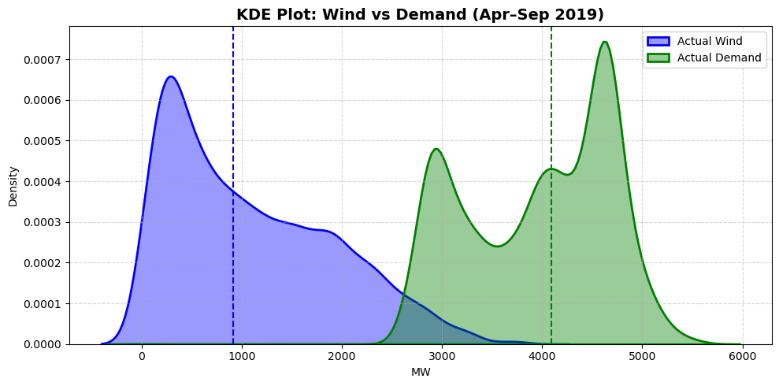
    


```python

##Plot Average Wind and Demand by Hour of Daay
```


```python
df['Timestamp'] = pd.to_datetime(df['Timestamp'], errors='coerce')

df['Hour'] = df['Timestamp'].dt.hour
```


```python


# Group by hour and calculate averages
#Find Wind/Demand ratio
hourly_avg = df.groupby('Hour')[[
    'Actual Demand (MW)', 'BM Price', 'Actual Wind (MW)'
]].mean()


hourly_avg['Wind/Demand Ratio (%)'] = (
    hourly_avg['Actual Wind (MW)'] / hourly_avg['Actual Demand (MW)']
) * 100


print(hourly_avg[['Actual Wind (MW)', 'Actual Demand (MW)', 'Wind/Demand Ratio (%)']])
```

          Actual Wind (MW)  Actual Demand (MW)  Wind/Demand Ratio (%)
    Hour                                                             
    0          1030.040984         3286.715847              31.339520
    1          1011.887978         3085.997268              32.789659
    2           993.221311         2971.500000              33.424914
    3           968.204918         2900.636612              33.379049
    4           963.620219         2892.349727              33.316172
    5           971.204918         2930.106557              33.145720
    6           988.795082         3211.314208              30.790979
    7          1011.762295         3752.852459              26.959821
    8          1021.718579         4230.983607              24.148488
    9          1048.087432         4467.032787              23.462721
    10         1096.693989         4529.980874              24.209683
    11         1146.330601         4564.092896              25.116285
    12         1180.579235         4584.825137              25.749711
    13         1209.532787         4515.756831              26.784719
    14         1220.609290         4433.866120              27.529232
    15         1232.792350         4407.871585              27.967973
    16         1250.530055         4494.281421              27.824917
    17         1250.669399         4645.234973              26.923706
    18         1208.516393         4599.210383              26.276606
    19         1150.961749         4441.068306              25.916326
    20         1099.092896         4348.005464              25.278094
    21         1080.877049         4242.486339              25.477443
    22         1070.043716         3980.680328              26.880926
    23         1055.054645         3585.027322              29.429473
    


```python

# Plot Hourly Average: Demand (Filled) vs Wind (Outlined) (Apr–Sep 2019)
plt.figure(figsize=(12, 5))

bar_width = 0.6
x = np.arange(len(hourly_avg))  # 0 to 23


plt.bar(x, hourly_avg['Actual Demand (MW)'],
        width=bar_width,
        label='Avg Demand (MW)',
        color='green',
        alpha=0.6)


plt.bar(x, hourly_avg['Actual Wind (MW)'],
        width=bar_width,
        label='Avg Wind (MW)',
        color='none',
        edgecolor='blue',
        linewidth=2)

for i, val in enumerate(hourly_avg['Actual Demand (MW)']):
    ratio = hourly_avg['Wind/Demand Ratio (%)'].iloc[i]
    plt.text(i, val + 100, f"{ratio:.0f}%", ha='center', va='bottom', fontsize=8, color='blue')

plt.xticks(ticks=x, labels=hourly_avg.index)
plt.xlabel("Hour of Day")
plt.ylabel("MW")
plt.title("Hourly Average: Demand (Filled) vs Wind (Outlined) (Apr–Sep 2019)", fontsize=14, fontweight='bold')
plt.legend()
plt.grid(axis='y', linestyle='--', alpha=0.5)
plt.tight_layout()
plt.savefig("Hourly Average: Demand (Filled) vs Wind (Outlined) (Apr–Sep 2019).png", dpi=300, bbox_inches="tight")
plt.show()


```


    
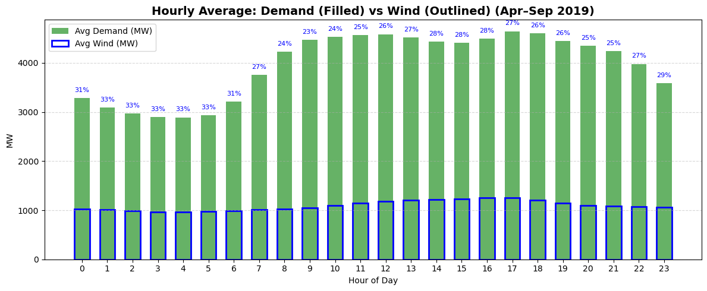
    


#This graph compares average hourly electricity demand (filled green bars) and wind generation (outlined blue bars) from April–September 2019. Wind met around 23–34% of hourly demand, with higher coverage during low-demand nighttime hours. As demand rises during the day, wind’s share drops, highlighting reliance on other generation sources.


```python

```


```python
# Demand Vs BM price
#Average Demand (Bar) and BM Price (Line) by Hour (Apr–Sep 2019)
```


```python


df['Timestamp'] = pd.to_datetime(df['Timestamp'], errors='coerce')
df['Actual Demand (MW)'] = pd.to_numeric(df['Actual Demand (MW)'], errors='coerce')
df['BM Price'] = pd.to_numeric(df['BM Price'], errors='coerce')


df_filtered = df[(df['Timestamp'] >= '2019-04-01') & (df['Timestamp'] <= '2019-09-30')].copy() # Filter Apr–Sep 2019
df_filtered.dropna(subset=['Actual Demand (MW)', 'BM Price'], inplace=True)
df_filtered['Hour'] = df_filtered['Timestamp'].dt.hour


hourly_avg = df_filtered.groupby('Hour')[['Actual Demand (MW)', 'BM Price']].mean() # Group by hour

```


```python
# Dual axis plot for Average Demand (Bar) and BM Price (Line) by Hour (Apr–Sep 2019

fig, ax1 = plt.subplots(figsize=(12, 6))

bar = ax1.bar(hourly_avg.index,
              hourly_avg['Actual Demand (MW)'],
              color='lightgreen',
              label='Avg Demand (MW)',
              alpha=0.7)

ax1.set_xlabel("Hour of Day")
ax1.set_ylabel("Average Demand (MW)", color='green')
ax1.tick_params(axis='y', labelcolor='green')
ax1.set_xticks(np.arange(0, 24, 1))


ax2 = ax1.twinx()
ax2.plot(hourly_avg.index,
         hourly_avg['BM Price'],
         color='red',
         marker='o',
         linewidth=2,
         label='Avg BM Price ')

ax2.axhline(0, color='black', linestyle='--', linewidth=1)
ax2.set_ylabel("Average BM Price ", color='red')
ax2.tick_params(axis='y', labelcolor='red')


plt.title("Average Demand (Bar) and BM Price (Line) by Hour (Apr–Sep 2019)", fontsize=14, fontweight='bold')
fig.tight_layout()
ax1.grid(axis='y', linestyle='--', alpha=0.4)


lines1, labels1 = ax1.get_legend_handles_labels()
lines2, labels2 = ax2.get_legend_handles_labels()
ax1.legend(lines1 + lines2, labels1 + labels2, loc='upper left')


max_demand_hour = hourly_avg['Actual Demand (MW)'].idxmax()
max_bm_price_hour = hourly_avg['BM Price'].idxmax()


for i, val in enumerate(hourly_avg['Actual Demand (MW)']):
    if i == max_demand_hour:
        ax1.text(i, val + 50, f"{val:.0f}", ha='center', va='bottom', fontsize=9, fontweight='bold', color='darkgreen')
    else:
        ax1.text(i, val + 50, f"{val:.0f}", ha='center', va='bottom', fontsize=8, color='green')


for i, val in enumerate(hourly_avg['BM Price']):
    if i == max_bm_price_hour:
        ax2.text(i, val + 1, f"{val:.1f}", ha='center', va='bottom', fontsize=9, fontweight='bold', color='darkred')
    else:
        ax2.text(i, val + 1, f"{val:.1f}", ha='center', va='bottom', fontsize=8, color='red')

plt.show()
```


    
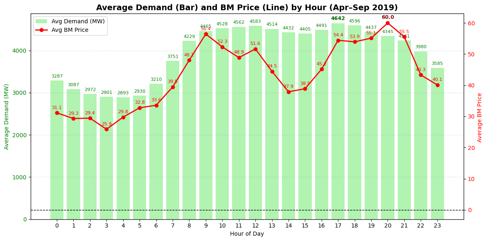
    


```python
#Demand increases sharply from 7 AM and peaks late afternoon. BM prices follow a similar trend, indicating price sensitivity to demand levels. The peak BM price occurs slightly after peak demand, suggesting supply-side constraints.
```


```python
# WInd Vs Bm Price
```


```python
df_filtered = df[(df['Timestamp'] >= '2019-04-01') & (df['Timestamp'] <= '2019-09-30')].copy()
df_filtered.dropna(subset=['Actual Wind (MW)', 'BM Price'], inplace=True)
df_filtered['Hour'] = df_filtered['Timestamp'].dt.hour


```


```python

hourly_avg = df_filtered.groupby('Hour')[['Actual Wind (MW)', 'BM Price']].mean()
x = np.arange(len(hourly_avg))  # 0-23 hours
bar_width = 0.6
```


```python
plt.figure(figsize=(12, 6))

#Hourly Avg: Wind (Filled) vs BM Price (Outlined) (Apr–Sep 2019
plt.bar(x,
        hourly_avg['Actual Wind (MW)'],
        width=bar_width,
        label='Avg Wind (MW)',
        color='skyblue',
        alpha=0.8)


plt.bar(x,
        hourly_avg['BM Price'],
        width=bar_width,
        label='Avg BM Price ',
        color='none',
        edgecolor='red',
        linewidth=2)


plt.xticks(ticks=x, labels=hourly_avg.index)
plt.xlabel("Hour of Day")
plt.ylabel("MW ")
plt.title("Hourly Avg: Wind (Filled) vs BM Price (Outlined) (Apr–Sep 2019)", fontsize=14, fontweight='bold')
plt.legend()
plt.grid(axis='y', linestyle='--', alpha=0.5)
plt.tight_layout()


for i, val in enumerate(hourly_avg['Actual Wind (MW)']):
    plt.text(i, val + 50, f"{val:.0f}", ha='center', va='bottom', fontsize=8, color='blue')


for i, val in enumerate(hourly_avg['BM Price']):
    plt.text(i, val + 20, f"{val:.1f}", ha='center', va='bottom', fontsize=8, color='red')

plt.show()
```


    
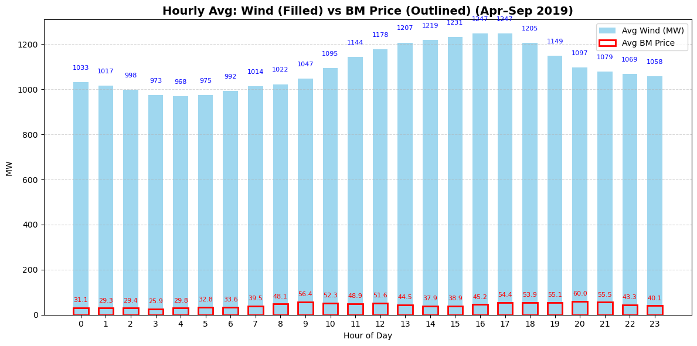
    


```python
# BM Price to see the distribution of negative and positive values.
```


```python
df['Timestamp'] = pd.to_datetime(df['Timestamp'], errors='coerce')
df['BM Price'] = pd.to_numeric(df['BM Price'], errors='coerce')
```


```python
df_raw = df[(df['Timestamp'] >= '2019-04-01') & (df['Timestamp'] <= '2019-09-30')].copy()
df_raw.dropna(subset=['BM Price'], inplace=True)


df_raw['Hour'] = df_raw['Timestamp'].dt.hour

```


```python


#Scatter plot Raw BM Prices by Hour of Day (Apr–Sep 2019


plt.figure(figsize=(12, 5))
plt.scatter(df_raw['Hour'], df_raw['BM Price'], alpha=0.3, color='red', s=10)

plt.title("Raw BM Prices by Hour of Day (Apr–Sep 2019)", fontsize=14, fontweight='bold')
plt.xlabel("Hour of Day")
plt.ylabel("BM Price ")
plt.xticks(range(0, 24))
plt.axhline(0, color='black', linestyle='--', linewidth=1)
plt.grid(True, linestyle='--', alpha=0.4)
plt.tight_layout()
plt.show()

```


    
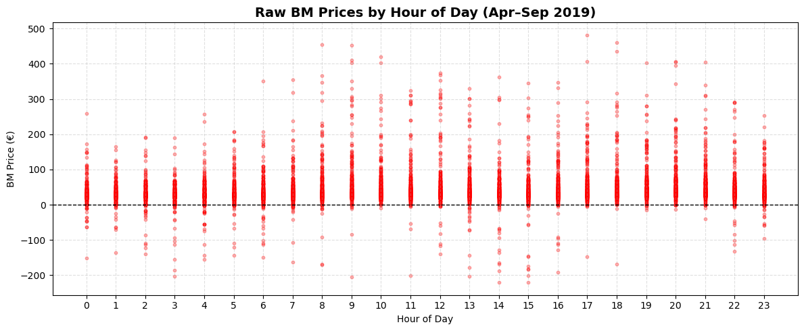
    


```python
# to anlayse the trend between the variables 
#Plot wind, demand, and BM price
```


```python

plt.figure(figsize=(14, 6))
plt.plot(df['Actual Wind (MW)'], label='Wind')
plt.plot(df['Actual Demand (MW)'], label='Demand')
plt.plot(df['BM Price'], label='BM Price')
plt.legend()
plt.title("Wind, Demand & BM Price Over Time")
plt.ylabel("Value")
plt.xlabel("Timestamp")
plt.tight_layout()
plt.show()
```


    
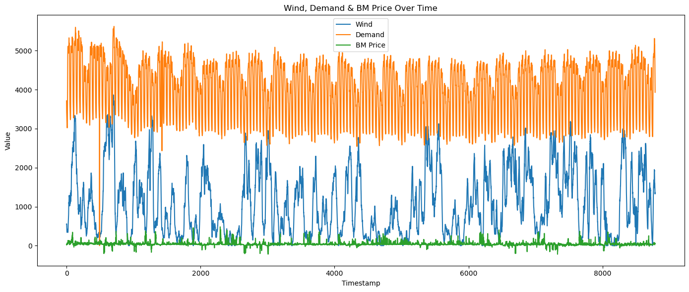
    


```python
sns.histplot(df['Actual Wind (MW)'], kde=True)
plt.title("Distribution of Wind Generation")
plt.show()

sns.histplot(df['Actual Demand (MW)'], kde=True)
plt.title("Distribution of Wind Generation")
plt.show()

sns.histplot(df['BM Price'], kde=True)
plt.title("Distribution of BM Prices")
plt.show()

# hist for wind, demand, price separately
```


    
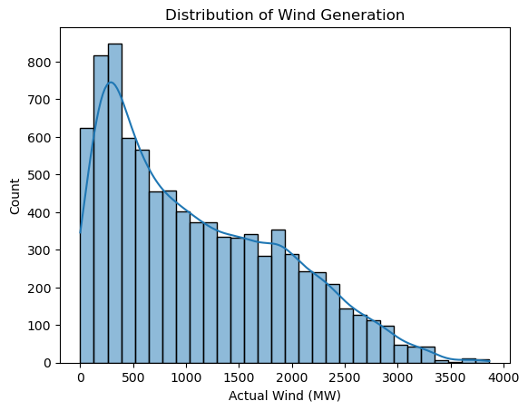
    


    
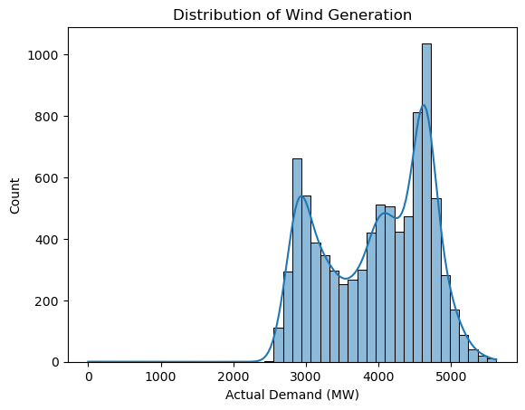
    


    
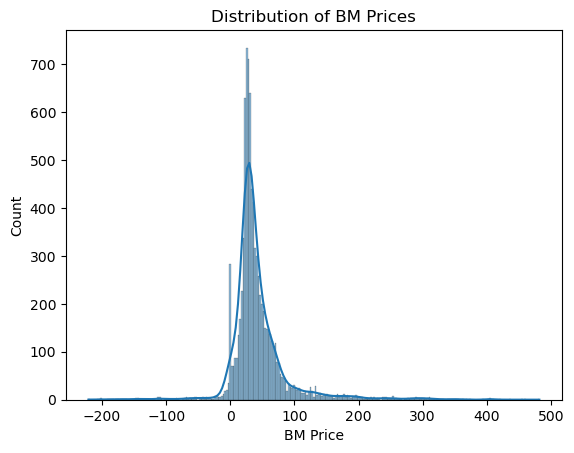
    


```python
numeric_cols = [
    'Actual Wind (MW)', 'Actual Demand (MW)', 'BM Price'
]

plt.figure(figsize=(10, 6))
sns.heatmap(df[numeric_cols].corr(), annot=True, cmap='coolwarm')
plt.title("Correlation Heatmap")
plt.show()
#to understnad the correlation between the varibales plotted correlation haetamap
```


    
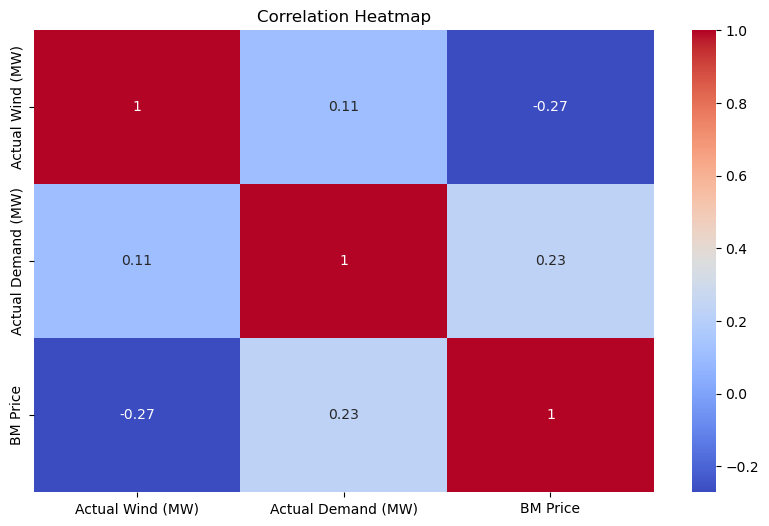
    


```python
#Plotting Acutal wind vs the forecasted DAM,IDA1,2 and 3 separately to understand 
```


```python
# Ensure datetime format
# Filter May 2019
# Ensure values are numeric (coerce bad strings to NaN, but preserve 0)
df['Start Date'] = pd.to_datetime(df['Start Date'], errors='coerce')

df_may = df[(df['Start Date'] >= '2019-05-01') & (df['Start Date'] <= '2019-05-31')].copy()


df_may['Actual Wind (MW)'] = pd.to_numeric(df_may['Actual Wind (MW)'], errors='coerce')
df_may['IDA3 Forecast ISEMWIND'] = pd.to_numeric(df_may['IDA3 Forecast ISEMWIND'], errors='coerce')


df_may = df_may.dropna(subset=['Actual Wind (MW)', 'IDA3 Forecast ISEMWIND'])

```


```python
plt.figure(figsize=(16, 6))

plt.plot(df_may['Start Date'], df_may['Actual Wind (MW)'], label='Actual Wind', color='blue', linewidth=1)
plt.plot(df_may['Start Date'], df_may['IDA3 Forecast ISEMWIND'], label='IDA3 Forecast', color='orange', linestyle='--', linewidth=1)

plt.title("Half Hourly Actual Wind vs IDA3 Forecast For May 2019", fontsize=14, fontweight='bold')
plt.xlabel("Date")
plt.ylabel("Wind Generation (MW)")

plt.gca().xaxis.set_major_formatter(mdates.DateFormatter('%b %d'))
plt.gca().xaxis.set_major_locator(mdates.DayLocator(interval=2))
plt.xticks(rotation=45)

plt.grid(True, linestyle='--', alpha=0.5)
plt.legend()
plt.tight_layout()
plt.show()
```


    
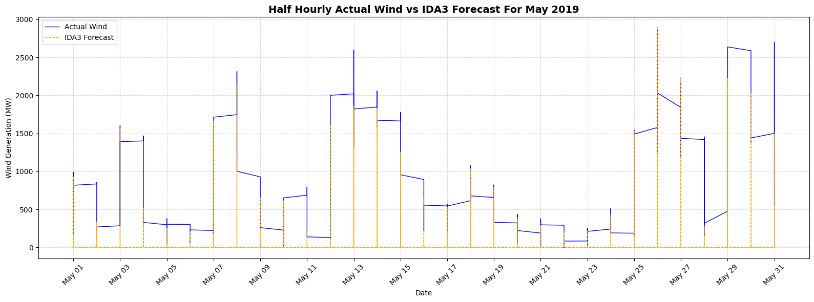
    


```python
# Plotting Actual Wind vs each forecast as facet plots for the month of may 
def facet_plot_wind_vs_forecasts(df, start_date, end_date, forecast_cols, actual_col='Actual Wind (MW)', date_col='Start Date'):
  
   
    df[date_col] = pd.to_datetime(df[date_col], errors='coerce')
    df_filtered = df[(df[date_col] >= start_date) & (df[date_col] <= end_date)].copy()

    
    df_filtered[actual_col] = pd.to_numeric(df_filtered[actual_col], errors='coerce')
    for col in forecast_cols:
        df_filtered[col] = pd.to_numeric(df_filtered[col], errors='coerce')

   
    df_filtered.dropna(subset=[actual_col] + forecast_cols, inplace=True)  # Drop rows with missing values in any relevant column

  
    n = len(forecast_cols)
    fig, axes = plt.subplots(n, 1, figsize=(16, 3.5 * n), sharex=True)
    if n == 1:
        axes = [axes] 

    for i, col in enumerate(forecast_cols):
        ax = axes[i]
        ax.plot(df_filtered[date_col], df_filtered[actual_col], label='Actual Wind', color='blue', linewidth=1.5)
        ax.plot(df_filtered[date_col], df_filtered[col], label=col, color='orange', linestyle='--', linewidth=1.2)
        ax.set_title(f"Actual Wind vs {col}", fontsize=12, fontweight='bold')
        ax.set_ylabel("MW")
        ax.grid(True, linestyle='--', alpha=0.5)
        ax.legend()


        if i == len(forecast_cols) - 1:
            ax.set_xlabel("Date and Time")
            ax.xaxis.set_major_formatter(mdates.DateFormatter('%b %d'))
            ax.xaxis.set_major_locator(mdates.DayLocator(interval=2))
            ax.tick_params(axis='x', rotation=45)

    fig.suptitle(f"Half-Hourly Actual Wind vs Forecasts ({start_date[:7]})", fontsize=14, fontweight='bold')
    plt.tight_layout(rect=[0, 0, 1, 0.96])
    plt.show()
```


```python
forecast_columns = [
    'DAM Forecast ISEMWIND',
    'IDA1 Forecast ISEMWIND',
    'IDA2 Forecast ISEMWIND',
    'IDA3 Forecast ISEMWIND'
]

facet_plot_wind_vs_forecasts(
    df=df,
    start_date='2019-05-01',
    end_date='2019-05-31',
    forecast_cols=forecast_columns
)
```


    
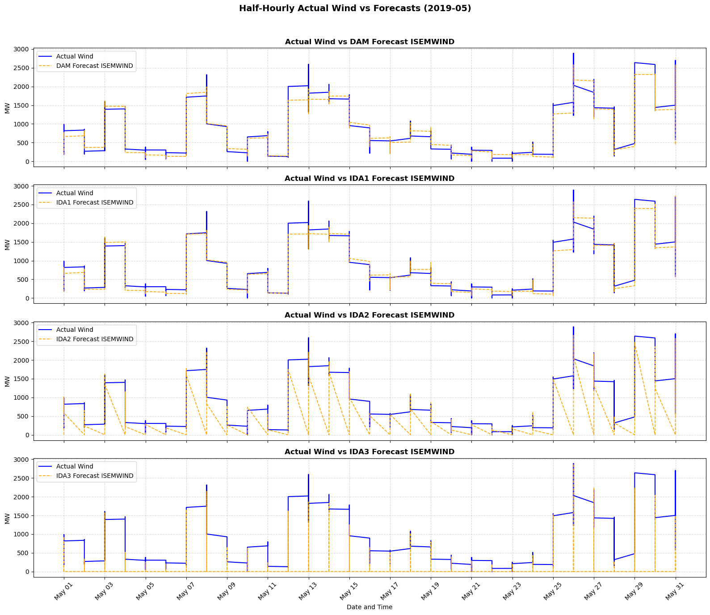
    


```python
#Plot Actual Demand vs each forecast as facets plots for a date range.

    
def facet_plot_demand_vs_forecasts(df, start_date, end_date,
                                    forecast_cols,
                                    actual_col='Actual Demand (MW)',
                                    date_col='Start Date'):
 

    df[date_col] = pd.to_datetime(df[date_col], errors='coerce')

   
    df_filtered = df[(df[date_col] >= start_date) & (df[date_col] <= end_date)].copy()

    
    df_filtered[actual_col] = pd.to_numeric(df_filtered[actual_col], errors='coerce')
    for col in forecast_cols:
        df_filtered[col] = pd.to_numeric(df_filtered[col], errors='coerce')

 
    df_filtered.dropna(subset=[actual_col] + forecast_cols, inplace=True)    #to Drop rows with NaNs in any required columns

   
    n = len(forecast_cols)
    fig, axes = plt.subplots(n, 1, figsize=(16, 3.5 * n), sharex=True)

    if n == 1:
        axes = [axes]  

    for i, col in enumerate(forecast_cols):
        ax = axes[i]
        ax.plot(df_filtered[date_col], df_filtered[actual_col], label='Actual Demand (MW)', color='blue', linewidth=1.5)
        ax.plot(df_filtered[date_col], df_filtered[col], label=col, color='orange', linestyle='--', linewidth=1.2)

        ax.set_title(f"Actual Demand vs {col}", fontsize=12, fontweight='bold')
        ax.set_ylabel("MW")
        ax.grid(True, linestyle='--', alpha=0.5)
        ax.legend()

       
        if i == n - 1:
            ax.set_xlabel("Date and Time")
            ax.xaxis.set_major_formatter(mdates.DateFormatter('%b %d'))
            ax.xaxis.set_major_locator(mdates.DayLocator(interval=2))
            ax.tick_params(axis='x', rotation=45)

    fig.suptitle(f"Half-Hourly Actual Demand vs Forecasts ({start_date[:7]})", fontsize=14, fontweight='bold')
    plt.tight_layout(rect=[0, 0, 1, 0.96])
    plt.show()
```


```python
demand_forecast_columns = [
    'DAM Forecast ISEMDEMAND (FC at 10am D-1)',
    'IDA1 Forecast ISEMDEMAND',
    'IDA2 Forecast ISEMDEMAND',
    'IDA3 Forecast ISEMDEMAND'
]

facet_plot_demand_vs_forecasts(
    df=df,  
    start_date='2019-05-01',
    end_date='2019-05-31',
    forecast_cols=demand_forecast_columns
)
```


    
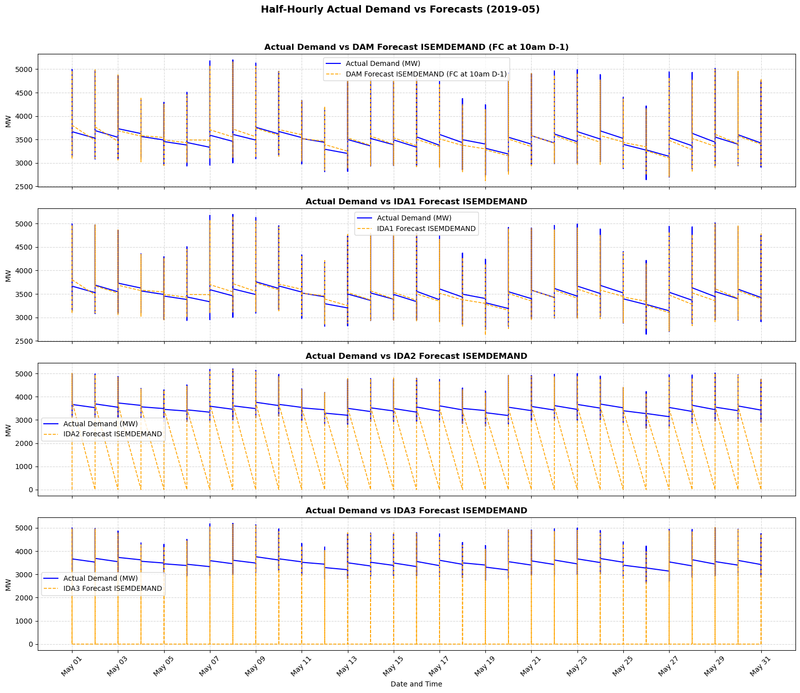
    


# forecast error
#Forecast Error = Actual – Forecast value
#So positive error means underforecasted, negative means overforecasted.
#Wind forecast


```python
df['Wind_Error_DAM'] = df['Actual Wind (MW)'] - df['DAM Forecast ISEMWIND']
df['Wind_Error_IDA1'] = df['Actual Wind (MW)'] - df['IDA1 Forecast ISEMWIND']
df['Wind_Error_IDA2'] = df['Actual Wind (MW)'] - df['IDA2 Forecast ISEMWIND']
df['Wind_Error_IDA3'] = df['Actual Wind (MW)'] - df['IDA3 Forecast ISEMWIND']
```


```python
Actual Wind vs DAM Forecast vs Error
```


```python

df['Date'] = df['Timestamp'].dt.date
daily_avg = df.groupby('Date')[['Actual Wind (MW)', 'DAM Forecast ISEMWIND', 'Wind_Error_DAM']].mean().reset_index()

```


```python

#Plot Daily Averag  Actual Wind vs DAM Forecast vs Forecast Error
x = np.arange(len(daily_avg))
bar_width = 0.25

plt.figure(figsize=(16, 6))


plt.bar(x - bar_width, daily_avg['Actual Wind (MW)'], width=bar_width, label='Actual Wind', color='yellow')


plt.bar(x, daily_avg['DAM Forecast ISEMWIND'], width=bar_width, label='DAM Forecast', color='skyblue')


plt.bar(x + bar_width, daily_avg['Wind_Error_DAM'], width=bar_width, label='Forecast Error', color='salmon')

plt.xticks(ticks=x[::7], labels=daily_avg['Date'].astype(str)[::7], rotation=45)
plt.axhline(0, color='black', linestyle='--', linewidth=1)


plt.title("Daily Average: Actual Wind vs DAM Forecast vs Forecast Error", fontsize=14, fontweight='bold')
plt.xlabel("Date")
plt.ylabel("MW")
plt.legend()
plt.grid(axis='y', linestyle='--', alpha=0.4)
plt.tight_layout()
plt.show()

```


    
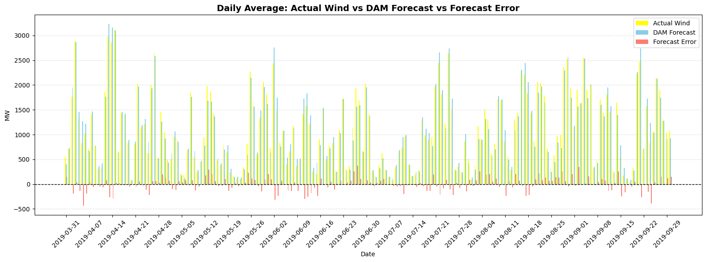
    


```python
# Function to plot   Actual wind Vs FOrecasts and errors
```


```python

def plot_forecast_vs_error(df):
    
    df['Timestamp'] = pd.to_datetime(df['Timestamp'], errors='coerce')
    df['Date'] = df['Timestamp'].dt.date

   
    df['Error_DAM']  = df['Actual Wind (MW)'] - df['DAM Forecast ISEMWIND']
    df['Error_IDA1'] = df['Actual Wind (MW)'] - df['IDA1 Forecast ISEMWIND']
    df['Error_IDA2'] = df['Actual Wind (MW)'] - df['IDA2 Forecast ISEMWIND']
    df['Error_IDA3'] = df['Actual Wind (MW)'] - df['IDA3 Forecast ISEMWIND']

 
    daily_avg = df.groupby('Date')[[
        'Actual Wind (MW)',
        'DAM Forecast ISEMWIND', 'IDA1 Forecast ISEMWIND', 'IDA2 Forecast ISEMWIND', 'IDA3 Forecast ISEMWIND',
        'Error_DAM', 'Error_IDA1', 'Error_IDA2', 'Error_IDA3'
    ]].mean().reset_index()

   
    x = np.arange(len(daily_avg))
    bar_width = 0.15

    plt.figure(figsize=(16, 6))

 
    plt.bar(x - 2*bar_width, daily_avg['Actual Wind (MW)'], width=bar_width, label='Actual Wind', color='green')

  
    plt.bar(x - bar_width, daily_avg['DAM Forecast ISEMWIND'], width=bar_width, label='DAM Forecast', color='skyblue')
    plt.bar(x, daily_avg['IDA1 Forecast ISEMWIND'], width=bar_width, label='IDA1 Forecast', color='dodgerblue')
    plt.bar(x + bar_width, daily_avg['IDA2 Forecast ISEMWIND'], width=bar_width, label='IDA2 Forecast', color='cornflowerblue')
    plt.bar(x + 2*bar_width, daily_avg['IDA3 Forecast ISEMWIND'], width=bar_width, label='IDA3 Forecast', color='blue')

  
    plt.axhline(0, color='black', linestyle='--', linewidth=1)
    plt.xticks(x[::7], daily_avg['Date'].astype(str)[::7], rotation=45)
    plt.ylabel("Wind (MW)")
    plt.title("Actual Wind vs Forecasts (DAM, IDA1–3) with Errors", fontsize=14, fontweight='bold')
    plt.legend()
    plt.grid(axis='y', linestyle='--', alpha=0.4)
    plt.tight_layout()
    plt.show()

```


```python
plot_forecast_vs_error(df)

```


    
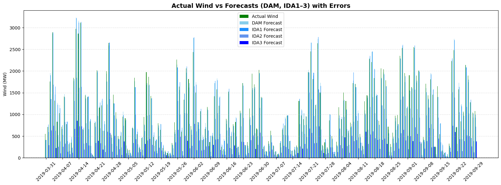
    


```python
# demand Forecats error
```

df['Demand_Error_DAM'] = df['Actual Demand (MW)'] - df['DAM Forecast ISEMDEMAND (FC at 10am D-1)']
df['Demand_Error_IDA1'] = df['Actual Demand (MW)'] - df['IDA1 Forecast ISEMDEMAND']
df['Demand_Error_IDA2'] = df['Actual Demand (MW)'] - df['IDA2 Forecast ISEMDEMAND']
df['Demand_Error_IDA3'] = df['Actual Demand (MW)'] - df['IDA3 Forecast ISEMDEMAND']


```python
def plot_demand_forecasts_vs_error(df):
   
    df['Timestamp'] = pd.to_datetime(df['Timestamp'], errors='coerce')
    df['Date'] = df['Timestamp'].dt.date

    
    df['Demand_Error_DAM']  = df['Actual Demand (MW)'] - df['DAM Forecast ISEMDEMAND (FC at 10am D-1)']
    df['Demand_Error_IDA1'] = df['Actual Demand (MW)'] - df['IDA1 Forecast ISEMDEMAND']
    df['Demand_Error_IDA2'] = df['Actual Demand (MW)'] - df['IDA2 Forecast ISEMDEMAND']
    df['Demand_Error_IDA3'] = df['Actual Demand (MW)'] - df['IDA3 Forecast ISEMDEMAND']

  
    daily_avg = df.groupby('Date')[[
        'Actual Demand (MW)',
        'DAM Forecast ISEMDEMAND (FC at 10am D-1)',
        'IDA1 Forecast ISEMDEMAND',
        'IDA2 Forecast ISEMDEMAND',
        'IDA3 Forecast ISEMDEMAND',
        'Demand_Error_DAM', 'Demand_Error_IDA1', 'Demand_Error_IDA2', 'Demand_Error_IDA3'
    ]].mean().reset_index()


    x = np.arange(len(daily_avg))
    bar_width = 0.12

    plt.figure(figsize=(16, 6))

    
    plt.bar(x - 2*bar_width, daily_avg['Actual Demand (MW)'], width=bar_width, label='Actual Demand', color='green')

 
    plt.bar(x - bar_width, daily_avg['DAM Forecast ISEMDEMAND (FC at 10am D-1)'], width=bar_width, label='DAM Forecast', color='#4682b4')
    plt.bar(x, daily_avg['IDA1 Forecast ISEMDEMAND'], width=bar_width, label='IDA1 Forecast', color='#87ceeb')
    plt.bar(x + bar_width, daily_avg['IDA2 Forecast ISEMDEMAND'], width=bar_width, label='IDA2 Forecast', color='#4169e1')
    plt.bar(x + 2*bar_width, daily_avg['IDA3 Forecast ISEMDEMAND'], width=bar_width, label='IDA3 Forecast', color='#000080')

  
    plt.xticks(x[::7], daily_avg['Date'].astype(str)[::7], rotation=45)
    plt.axhline(0, color='black', linestyle='--', linewidth=1)
    plt.ylabel("Demand (MW)")
    plt.title("Actual Demand vs Forecasts (DAM, IDA1–3) with Errors", fontsize=14, fontweight='bold')
    plt.legend()
    plt.grid(axis='y', linestyle='--', alpha=0.85)
    plt.tight_layout()
    plt.show()
```


```python
plot_demand_forecasts_vs_error(df)

```


    
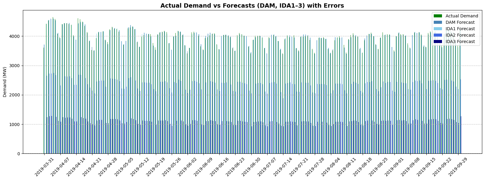
    


```python
#Price Deviation from BM (not forecast per se, but relevant)
```

df['Price_Diff_DAM'] = df['BM Price'] - df['DA Price']
df['Price_Diff_IDA1'] = df['BM Price'] - df['IDA1 Price']
df['Price_Diff_IDA2'] = df['BM Price'] - df['IDA2 Price']
df['Price_Diff_IDA3'] = df['BM Price'] - df['IDA3 Price']


```python
def plot_price_deviation_vs_bm(df):
   
    df['Timestamp'] = pd.to_datetime(df['Timestamp'], errors='coerce')
    df['Date'] = df['Timestamp'].dt.date

   
    df['Price_Diff_DAM']  = df['BM Price'] - df['DA Price']
    df['Price_Diff_IDA1'] = df['BM Price'] - df['IDA1 Price']
    df['Price_Diff_IDA2'] = df['BM Price'] - df['IDA2 Price']
    df['Price_Diff_IDA3'] = df['BM Price'] - df['IDA3 Price']

   
    daily_avg = df.groupby('Date')[[
        'BM Price',
        'DA Price', 'IDA1 Price', 'IDA2 Price', 'IDA3 Price',
        'Price_Diff_DAM', 'Price_Diff_IDA1', 'Price_Diff_IDA2', 'Price_Diff_IDA3'
    ]].mean().reset_index()

   
    x = np.arange(len(daily_avg))
    bar_width = 0.15
    plt.figure(figsize=(16, 6))

  
    plt.bar(x - 2*bar_width, daily_avg['BM Price'], width=bar_width, label='BM Price', color='red')

  
    plt.bar(x - bar_width, daily_avg['DA Price'], width=bar_width, label='DA Price', color='#4682b4')
    plt.bar(x, daily_avg['IDA1 Price'], width=bar_width, label='IDA1 Price', color='#87ceeb')
    plt.bar(x + bar_width, daily_avg['IDA2 Price'], width=bar_width, label='IDA2 Price', color='#4169e1')
    plt.bar(x + 2*bar_width, daily_avg['IDA3 Price'], width=bar_width, label='IDA3 Price', color='#000080')

    
    plt.xticks(x[::7], daily_avg['Date'].astype(str)[::7], rotation=45)
    plt.axhline(0, color='black', linestyle='--', linewidth=1)
    plt.ylabel("MWh")
    plt.title("BM Price vs Forecasted Market Prices (DA, IDA1–3)", fontsize=14, fontweight='bold')
    plt.legend()
    plt.grid(axis='y', linestyle='--', alpha=0.4)
    plt.tight_layout()
    plt.show()
```


```python
plot_price_deviation_vs_bm(df)
```


    
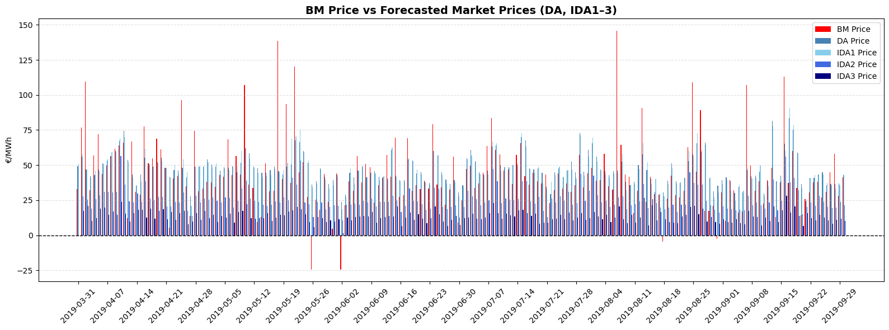
    


#finding Net Demand
#Net Demand = Actual Demand – Actual Wind Generation


```python
df['Net_Demand'] = df['Actual Demand (MW)'] - df['Actual Wind (MW)']
df
```


<div>
<style scoped>
    .dataframe tbody tr th:only-of-type {
        vertical-align: middle;
    }

    .dataframe tbody tr th {
        vertical-align: top;
    }

    .dataframe thead th {
        text-align: right;
    }
</style>
<table border="1" class="dataframe">
  <thead>
    <tr style="text-align: right;">
      <th></th>
      <th>Timestamp</th>
      <th>Actual Wind (MW)</th>
      <th>DAM Forecast ISEMWIND</th>
      <th>IDA1 Forecast ISEMWIND</th>
      <th>IDA2 Forecast ISEMWIND</th>
      <th>IDA3 Forecast ISEMWIND</th>
      <th>Actual Demand (MW)</th>
      <th>DAM Forecast ISEMDEMAND (FC at 10am D-1)</th>
      <th>IDA1 Forecast ISEMDEMAND</th>
      <th>IDA2 Forecast ISEMDEMAND</th>
      <th>...</th>
      <th>Date</th>
      <th>Error_DAM</th>
      <th>Error_IDA1</th>
      <th>Error_IDA2</th>
      <th>Error_IDA3</th>
      <th>Demand_Error_DAM</th>
      <th>Demand_Error_IDA1</th>
      <th>Demand_Error_IDA2</th>
      <th>Demand_Error_IDA3</th>
      <th>Net_Demand</th>
    </tr>
  </thead>
  <tbody>
    <tr>
      <th>0</th>
      <td>2019-03-31 23:00:00</td>
      <td>549</td>
      <td>404</td>
      <td>412</td>
      <td>0.0</td>
      <td>0.0</td>
      <td>3714</td>
      <td>3713</td>
      <td>3712</td>
      <td>0.0</td>
      <td>...</td>
      <td>2019-03-31</td>
      <td>145</td>
      <td>137</td>
      <td>549.0</td>
      <td>549.0</td>
      <td>1</td>
      <td>2</td>
      <td>3714.0</td>
      <td>3714.0</td>
      <td>3165</td>
    </tr>
    <tr>
      <th>1</th>
      <td>2019-03-31 23:30:00</td>
      <td>558</td>
      <td>404</td>
      <td>412</td>
      <td>0.0</td>
      <td>0.0</td>
      <td>3504</td>
      <td>3713</td>
      <td>3712</td>
      <td>0.0</td>
      <td>...</td>
      <td>2019-03-31</td>
      <td>154</td>
      <td>146</td>
      <td>558.0</td>
      <td>558.0</td>
      <td>-209</td>
      <td>-208</td>
      <td>3504.0</td>
      <td>3504.0</td>
      <td>2946</td>
    </tr>
    <tr>
      <th>2</th>
      <td>2019-04-01 00:00:00</td>
      <td>544</td>
      <td>380</td>
      <td>401</td>
      <td>0.0</td>
      <td>0.0</td>
      <td>3427</td>
      <td>3456</td>
      <td>3456</td>
      <td>0.0</td>
      <td>...</td>
      <td>2019-04-01</td>
      <td>164</td>
      <td>143</td>
      <td>544.0</td>
      <td>544.0</td>
      <td>-29</td>
      <td>-29</td>
      <td>3427.0</td>
      <td>3427.0</td>
      <td>2883</td>
    </tr>
    <tr>
      <th>3</th>
      <td>2019-04-01 00:30:00</td>
      <td>492</td>
      <td>380</td>
      <td>401</td>
      <td>0.0</td>
      <td>0.0</td>
      <td>3362</td>
      <td>3456</td>
      <td>3456</td>
      <td>0.0</td>
      <td>...</td>
      <td>2019-04-01</td>
      <td>112</td>
      <td>91</td>
      <td>492.0</td>
      <td>492.0</td>
      <td>-94</td>
      <td>-94</td>
      <td>3362.0</td>
      <td>3362.0</td>
      <td>2870</td>
    </tr>
    <tr>
      <th>4</th>
      <td>2019-04-01 01:00:00</td>
      <td>459</td>
      <td>366</td>
      <td>391</td>
      <td>0.0</td>
      <td>0.0</td>
      <td>3267</td>
      <td>3237</td>
      <td>3234</td>
      <td>0.0</td>
      <td>...</td>
      <td>2019-04-01</td>
      <td>93</td>
      <td>68</td>
      <td>459.0</td>
      <td>459.0</td>
      <td>30</td>
      <td>33</td>
      <td>3267.0</td>
      <td>3267.0</td>
      <td>2808</td>
    </tr>
    <tr>
      <th>...</th>
      <td>...</td>
      <td>...</td>
      <td>...</td>
      <td>...</td>
      <td>...</td>
      <td>...</td>
      <td>...</td>
      <td>...</td>
      <td>...</td>
      <td>...</td>
      <td>...</td>
      <td>...</td>
      <td>...</td>
      <td>...</td>
      <td>...</td>
      <td>...</td>
      <td>...</td>
      <td>...</td>
      <td>...</td>
      <td>...</td>
      <td>...</td>
    </tr>
    <tr>
      <th>8779</th>
      <td>2019-09-30 20:30:00</td>
      <td>1530</td>
      <td>995</td>
      <td>1087</td>
      <td>1107.0</td>
      <td>1400.0</td>
      <td>4857</td>
      <td>4847</td>
      <td>4849</td>
      <td>4849.0</td>
      <td>...</td>
      <td>2019-09-30</td>
      <td>535</td>
      <td>443</td>
      <td>423.0</td>
      <td>130.0</td>
      <td>10</td>
      <td>8</td>
      <td>8.0</td>
      <td>-44.0</td>
      <td>3327</td>
    </tr>
    <tr>
      <th>8780</th>
      <td>2019-09-30 21:00:00</td>
      <td>1499</td>
      <td>950</td>
      <td>1032</td>
      <td>1054.0</td>
      <td>1340.0</td>
      <td>4687</td>
      <td>4657</td>
      <td>4658</td>
      <td>4658.0</td>
      <td>...</td>
      <td>2019-09-30</td>
      <td>549</td>
      <td>467</td>
      <td>445.0</td>
      <td>159.0</td>
      <td>30</td>
      <td>29</td>
      <td>29.0</td>
      <td>-30.0</td>
      <td>3188</td>
    </tr>
    <tr>
      <th>8781</th>
      <td>2019-09-30 21:30:00</td>
      <td>1390</td>
      <td>930</td>
      <td>987</td>
      <td>1003.0</td>
      <td>1284.0</td>
      <td>4421</td>
      <td>4437</td>
      <td>4437</td>
      <td>4437.0</td>
      <td>...</td>
      <td>2019-09-30</td>
      <td>460</td>
      <td>403</td>
      <td>387.0</td>
      <td>106.0</td>
      <td>-16</td>
      <td>-16</td>
      <td>-16.0</td>
      <td>-67.0</td>
      <td>3031</td>
    </tr>
    <tr>
      <th>8782</th>
      <td>2019-09-30 22:00:00</td>
      <td>1326</td>
      <td>915</td>
      <td>956</td>
      <td>969.0</td>
      <td>1232.0</td>
      <td>4181</td>
      <td>4189</td>
      <td>4190</td>
      <td>4190.0</td>
      <td>...</td>
      <td>2019-09-30</td>
      <td>411</td>
      <td>370</td>
      <td>357.0</td>
      <td>94.0</td>
      <td>-8</td>
      <td>-9</td>
      <td>-9.0</td>
      <td>-35.0</td>
      <td>2855</td>
    </tr>
    <tr>
      <th>8783</th>
      <td>2019-09-30 22:30:00</td>
      <td>1356</td>
      <td>905</td>
      <td>939</td>
      <td>951.0</td>
      <td>1187.0</td>
      <td>3932</td>
      <td>3932</td>
      <td>3934</td>
      <td>3934.0</td>
      <td>...</td>
      <td>2019-09-30</td>
      <td>451</td>
      <td>417</td>
      <td>405.0</td>
      <td>169.0</td>
      <td>0</td>
      <td>-2</td>
      <td>-2.0</td>
      <td>-6.0</td>
      <td>2576</td>
    </tr>
  </tbody>
</table>
<p>8784 rows × 33 columns</p>
</div>


```python
# plotting Net demand

plt.figure(figsize=(14, 5))
df['Net_Demand'].plot(label='Net Demand (MW)', color='darkorange')
plt.title("Net Demand Over Time")
plt.ylabel("MW")
plt.xlabel("Time")
plt.legend()
plt.tight_layout()
plt.show()

```


    
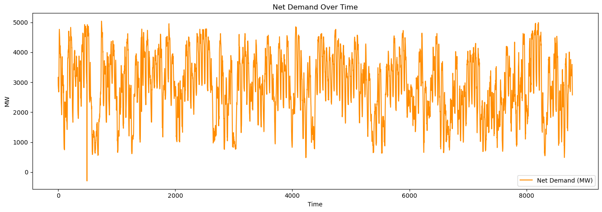
    


```python
#High net demand = energia has the pressure to rely on  BM Price

#Low net demand = high wind generation  = Low BM Price


```


```python
df['Net_Demand_Smooth'] = df['Net_Demand'].rolling(window=48).mean()
df['BM_Price_Smooth'] = df['BM Price'].rolling(window=48).mean()
plt.figure(figsize=(14, 6))
plt.plot(df['Net_Demand_Smooth'], label='Net Demand (1-day rolling avg)', color='orange')
plt.twinx()
plt.plot(df['BM_Price_Smooth'], label='BM Price (1-day rolling avg)', color='blue')

plt.title("Net Demand vs BM Price")
plt.xlabel("Time")
plt.ylabel("MW ")
plt.legend(loc='upper left')
plt.tight_layout()
plt.show()

```


    
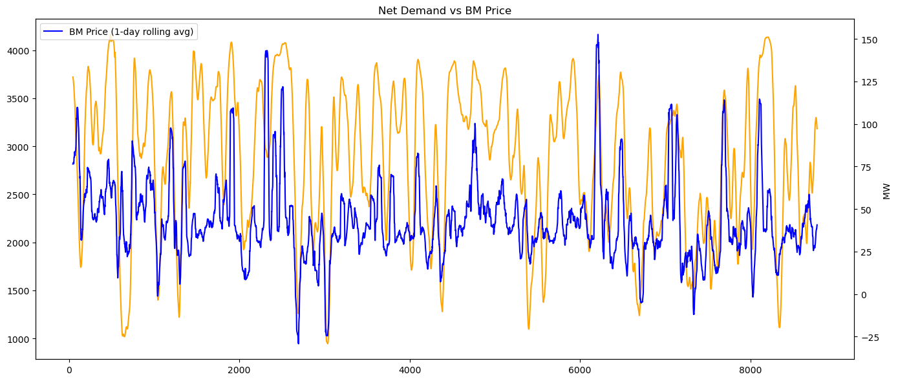
    


```python
# few demand driven price spike throught out the month is visible as net demand increases price also increased
# for some BM price stays flat when net demand is high, it may be due to other market effects 
```


```python
# Modelling
```


```python
df['Best_Market'] = df[['DA Price', 'IDA1 Price', 'IDA2 Price', 'IDA3 Price', 'BM Price']].idxmin(axis=1)
df
```


<div>
<style scoped>
    .dataframe tbody tr th:only-of-type {
        vertical-align: middle;
    }

    .dataframe tbody tr th {
        vertical-align: top;
    }

    .dataframe thead th {
        text-align: right;
    }
</style>
<table border="1" class="dataframe">
  <thead>
    <tr style="text-align: right;">
      <th></th>
      <th>Timestamp</th>
      <th>Actual Wind (MW)</th>
      <th>DAM Forecast ISEMWIND</th>
      <th>IDA1 Forecast ISEMWIND</th>
      <th>IDA2 Forecast ISEMWIND</th>
      <th>IDA3 Forecast ISEMWIND</th>
      <th>Actual Demand (MW)</th>
      <th>DAM Forecast ISEMDEMAND (FC at 10am D-1)</th>
      <th>IDA1 Forecast ISEMDEMAND</th>
      <th>IDA2 Forecast ISEMDEMAND</th>
      <th>...</th>
      <th>Error_IDA2</th>
      <th>Error_IDA3</th>
      <th>Demand_Error_DAM</th>
      <th>Demand_Error_IDA1</th>
      <th>Demand_Error_IDA2</th>
      <th>Demand_Error_IDA3</th>
      <th>Net_Demand</th>
      <th>Net_Demand_Smooth</th>
      <th>BM_Price_Smooth</th>
      <th>Best_Market</th>
    </tr>
  </thead>
  <tbody>
    <tr>
      <th>0</th>
      <td>2019-03-31 23:00:00</td>
      <td>549</td>
      <td>404</td>
      <td>412</td>
      <td>0.0</td>
      <td>0.0</td>
      <td>3714</td>
      <td>3713</td>
      <td>3712</td>
      <td>0.0</td>
      <td>...</td>
      <td>549.0</td>
      <td>549.0</td>
      <td>1</td>
      <td>2</td>
      <td>3714.0</td>
      <td>3714.0</td>
      <td>3165</td>
      <td>NaN</td>
      <td>NaN</td>
      <td>IDA2 Price</td>
    </tr>
    <tr>
      <th>1</th>
      <td>2019-03-31 23:30:00</td>
      <td>558</td>
      <td>404</td>
      <td>412</td>
      <td>0.0</td>
      <td>0.0</td>
      <td>3504</td>
      <td>3713</td>
      <td>3712</td>
      <td>0.0</td>
      <td>...</td>
      <td>558.0</td>
      <td>558.0</td>
      <td>-209</td>
      <td>-208</td>
      <td>3504.0</td>
      <td>3504.0</td>
      <td>2946</td>
      <td>NaN</td>
      <td>NaN</td>
      <td>IDA2 Price</td>
    </tr>
    <tr>
      <th>2</th>
      <td>2019-04-01 00:00:00</td>
      <td>544</td>
      <td>380</td>
      <td>401</td>
      <td>0.0</td>
      <td>0.0</td>
      <td>3427</td>
      <td>3456</td>
      <td>3456</td>
      <td>0.0</td>
      <td>...</td>
      <td>544.0</td>
      <td>544.0</td>
      <td>-29</td>
      <td>-29</td>
      <td>3427.0</td>
      <td>3427.0</td>
      <td>2883</td>
      <td>NaN</td>
      <td>NaN</td>
      <td>IDA2 Price</td>
    </tr>
    <tr>
      <th>3</th>
      <td>2019-04-01 00:30:00</td>
      <td>492</td>
      <td>380</td>
      <td>401</td>
      <td>0.0</td>
      <td>0.0</td>
      <td>3362</td>
      <td>3456</td>
      <td>3456</td>
      <td>0.0</td>
      <td>...</td>
      <td>492.0</td>
      <td>492.0</td>
      <td>-94</td>
      <td>-94</td>
      <td>3362.0</td>
      <td>3362.0</td>
      <td>2870</td>
      <td>NaN</td>
      <td>NaN</td>
      <td>IDA2 Price</td>
    </tr>
    <tr>
      <th>4</th>
      <td>2019-04-01 01:00:00</td>
      <td>459</td>
      <td>366</td>
      <td>391</td>
      <td>0.0</td>
      <td>0.0</td>
      <td>3267</td>
      <td>3237</td>
      <td>3234</td>
      <td>0.0</td>
      <td>...</td>
      <td>459.0</td>
      <td>459.0</td>
      <td>30</td>
      <td>33</td>
      <td>3267.0</td>
      <td>3267.0</td>
      <td>2808</td>
      <td>NaN</td>
      <td>NaN</td>
      <td>IDA2 Price</td>
    </tr>
    <tr>
      <th>...</th>
      <td>...</td>
      <td>...</td>
      <td>...</td>
      <td>...</td>
      <td>...</td>
      <td>...</td>
      <td>...</td>
      <td>...</td>
      <td>...</td>
      <td>...</td>
      <td>...</td>
      <td>...</td>
      <td>...</td>
      <td>...</td>
      <td>...</td>
      <td>...</td>
      <td>...</td>
      <td>...</td>
      <td>...</td>
      <td>...</td>
      <td>...</td>
    </tr>
    <tr>
      <th>8779</th>
      <td>2019-09-30 20:30:00</td>
      <td>1530</td>
      <td>995</td>
      <td>1087</td>
      <td>1107.0</td>
      <td>1400.0</td>
      <td>4857</td>
      <td>4847</td>
      <td>4849</td>
      <td>4849.0</td>
      <td>...</td>
      <td>423.0</td>
      <td>130.0</td>
      <td>10</td>
      <td>8</td>
      <td>8.0</td>
      <td>-44.0</td>
      <td>3327</td>
      <td>3243.479167</td>
      <td>38.386042</td>
      <td>BM Price</td>
    </tr>
    <tr>
      <th>8780</th>
      <td>2019-09-30 21:00:00</td>
      <td>1499</td>
      <td>950</td>
      <td>1032</td>
      <td>1054.0</td>
      <td>1340.0</td>
      <td>4687</td>
      <td>4657</td>
      <td>4658</td>
      <td>4658.0</td>
      <td>...</td>
      <td>445.0</td>
      <td>159.0</td>
      <td>30</td>
      <td>29</td>
      <td>29.0</td>
      <td>-30.0</td>
      <td>3188</td>
      <td>3228.937500</td>
      <td>39.263750</td>
      <td>IDA3 Price</td>
    </tr>
    <tr>
      <th>8781</th>
      <td>2019-09-30 21:30:00</td>
      <td>1390</td>
      <td>930</td>
      <td>987</td>
      <td>1003.0</td>
      <td>1284.0</td>
      <td>4421</td>
      <td>4437</td>
      <td>4437</td>
      <td>4437.0</td>
      <td>...</td>
      <td>387.0</td>
      <td>106.0</td>
      <td>-16</td>
      <td>-16</td>
      <td>-16.0</td>
      <td>-67.0</td>
      <td>3031</td>
      <td>3214.770833</td>
      <td>39.680833</td>
      <td>IDA3 Price</td>
    </tr>
    <tr>
      <th>8782</th>
      <td>2019-09-30 22:00:00</td>
      <td>1326</td>
      <td>915</td>
      <td>956</td>
      <td>969.0</td>
      <td>1232.0</td>
      <td>4181</td>
      <td>4189</td>
      <td>4190</td>
      <td>4190.0</td>
      <td>...</td>
      <td>357.0</td>
      <td>94.0</td>
      <td>-8</td>
      <td>-9</td>
      <td>-9.0</td>
      <td>-35.0</td>
      <td>2855</td>
      <td>3200.375000</td>
      <td>40.111042</td>
      <td>IDA3 Price</td>
    </tr>
    <tr>
      <th>8783</th>
      <td>2019-09-30 22:30:00</td>
      <td>1356</td>
      <td>905</td>
      <td>939</td>
      <td>951.0</td>
      <td>1187.0</td>
      <td>3932</td>
      <td>3932</td>
      <td>3934</td>
      <td>3934.0</td>
      <td>...</td>
      <td>405.0</td>
      <td>169.0</td>
      <td>0</td>
      <td>-2</td>
      <td>-2.0</td>
      <td>-6.0</td>
      <td>2576</td>
      <td>3183.208333</td>
      <td>40.674375</td>
      <td>IDA3 Price</td>
    </tr>
  </tbody>
</table>
<p>8784 rows × 36 columns</p>
</div>


```python
df['Best_Cost'] = df[['DA Price', 'IDA1 Price', 'IDA2 Price', 'IDA3 Price', 'BM Price']].min(axis=1) * 100 / 2  
df
```


<div>
<style scoped>
    .dataframe tbody tr th:only-of-type {
        vertical-align: middle;
    }

    .dataframe tbody tr th {
        vertical-align: top;
    }

    .dataframe thead th {
        text-align: right;
    }
</style>
<table border="1" class="dataframe">
  <thead>
    <tr style="text-align: right;">
      <th></th>
      <th>Timestamp</th>
      <th>Actual Wind (MW)</th>
      <th>DAM Forecast ISEMWIND</th>
      <th>IDA1 Forecast ISEMWIND</th>
      <th>IDA2 Forecast ISEMWIND</th>
      <th>IDA3 Forecast ISEMWIND</th>
      <th>Actual Demand (MW)</th>
      <th>DAM Forecast ISEMDEMAND (FC at 10am D-1)</th>
      <th>IDA1 Forecast ISEMDEMAND</th>
      <th>IDA2 Forecast ISEMDEMAND</th>
      <th>...</th>
      <th>Error_IDA3</th>
      <th>Demand_Error_DAM</th>
      <th>Demand_Error_IDA1</th>
      <th>Demand_Error_IDA2</th>
      <th>Demand_Error_IDA3</th>
      <th>Net_Demand</th>
      <th>Net_Demand_Smooth</th>
      <th>BM_Price_Smooth</th>
      <th>Best_Market</th>
      <th>Best_Cost</th>
    </tr>
  </thead>
  <tbody>
    <tr>
      <th>0</th>
      <td>2019-03-31 23:00:00</td>
      <td>549</td>
      <td>404</td>
      <td>412</td>
      <td>0.0</td>
      <td>0.0</td>
      <td>3714</td>
      <td>3713</td>
      <td>3712</td>
      <td>0.0</td>
      <td>...</td>
      <td>549.0</td>
      <td>1</td>
      <td>2</td>
      <td>3714.0</td>
      <td>3714.0</td>
      <td>3165</td>
      <td>NaN</td>
      <td>NaN</td>
      <td>IDA2 Price</td>
      <td>0.0</td>
    </tr>
    <tr>
      <th>1</th>
      <td>2019-03-31 23:30:00</td>
      <td>558</td>
      <td>404</td>
      <td>412</td>
      <td>0.0</td>
      <td>0.0</td>
      <td>3504</td>
      <td>3713</td>
      <td>3712</td>
      <td>0.0</td>
      <td>...</td>
      <td>558.0</td>
      <td>-209</td>
      <td>-208</td>
      <td>3504.0</td>
      <td>3504.0</td>
      <td>2946</td>
      <td>NaN</td>
      <td>NaN</td>
      <td>IDA2 Price</td>
      <td>0.0</td>
    </tr>
    <tr>
      <th>2</th>
      <td>2019-04-01 00:00:00</td>
      <td>544</td>
      <td>380</td>
      <td>401</td>
      <td>0.0</td>
      <td>0.0</td>
      <td>3427</td>
      <td>3456</td>
      <td>3456</td>
      <td>0.0</td>
      <td>...</td>
      <td>544.0</td>
      <td>-29</td>
      <td>-29</td>
      <td>3427.0</td>
      <td>3427.0</td>
      <td>2883</td>
      <td>NaN</td>
      <td>NaN</td>
      <td>IDA2 Price</td>
      <td>0.0</td>
    </tr>
    <tr>
      <th>3</th>
      <td>2019-04-01 00:30:00</td>
      <td>492</td>
      <td>380</td>
      <td>401</td>
      <td>0.0</td>
      <td>0.0</td>
      <td>3362</td>
      <td>3456</td>
      <td>3456</td>
      <td>0.0</td>
      <td>...</td>
      <td>492.0</td>
      <td>-94</td>
      <td>-94</td>
      <td>3362.0</td>
      <td>3362.0</td>
      <td>2870</td>
      <td>NaN</td>
      <td>NaN</td>
      <td>IDA2 Price</td>
      <td>0.0</td>
    </tr>
    <tr>
      <th>4</th>
      <td>2019-04-01 01:00:00</td>
      <td>459</td>
      <td>366</td>
      <td>391</td>
      <td>0.0</td>
      <td>0.0</td>
      <td>3267</td>
      <td>3237</td>
      <td>3234</td>
      <td>0.0</td>
      <td>...</td>
      <td>459.0</td>
      <td>30</td>
      <td>33</td>
      <td>3267.0</td>
      <td>3267.0</td>
      <td>2808</td>
      <td>NaN</td>
      <td>NaN</td>
      <td>IDA2 Price</td>
      <td>0.0</td>
    </tr>
    <tr>
      <th>...</th>
      <td>...</td>
      <td>...</td>
      <td>...</td>
      <td>...</td>
      <td>...</td>
      <td>...</td>
      <td>...</td>
      <td>...</td>
      <td>...</td>
      <td>...</td>
      <td>...</td>
      <td>...</td>
      <td>...</td>
      <td>...</td>
      <td>...</td>
      <td>...</td>
      <td>...</td>
      <td>...</td>
      <td>...</td>
      <td>...</td>
      <td>...</td>
    </tr>
    <tr>
      <th>8779</th>
      <td>2019-09-30 20:30:00</td>
      <td>1530</td>
      <td>995</td>
      <td>1087</td>
      <td>1107.0</td>
      <td>1400.0</td>
      <td>4857</td>
      <td>4847</td>
      <td>4849</td>
      <td>4849.0</td>
      <td>...</td>
      <td>130.0</td>
      <td>10</td>
      <td>8</td>
      <td>8.0</td>
      <td>-44.0</td>
      <td>3327</td>
      <td>3243.479167</td>
      <td>38.386042</td>
      <td>BM Price</td>
      <td>1170.0</td>
    </tr>
    <tr>
      <th>8780</th>
      <td>2019-09-30 21:00:00</td>
      <td>1499</td>
      <td>950</td>
      <td>1032</td>
      <td>1054.0</td>
      <td>1340.0</td>
      <td>4687</td>
      <td>4657</td>
      <td>4658</td>
      <td>4658.0</td>
      <td>...</td>
      <td>159.0</td>
      <td>30</td>
      <td>29</td>
      <td>29.0</td>
      <td>-30.0</td>
      <td>3188</td>
      <td>3228.937500</td>
      <td>39.263750</td>
      <td>IDA3 Price</td>
      <td>1800.0</td>
    </tr>
    <tr>
      <th>8781</th>
      <td>2019-09-30 21:30:00</td>
      <td>1390</td>
      <td>930</td>
      <td>987</td>
      <td>1003.0</td>
      <td>1284.0</td>
      <td>4421</td>
      <td>4437</td>
      <td>4437</td>
      <td>4437.0</td>
      <td>...</td>
      <td>106.0</td>
      <td>-16</td>
      <td>-16</td>
      <td>-16.0</td>
      <td>-67.0</td>
      <td>3031</td>
      <td>3214.770833</td>
      <td>39.680833</td>
      <td>IDA3 Price</td>
      <td>1405.0</td>
    </tr>
    <tr>
      <th>8782</th>
      <td>2019-09-30 22:00:00</td>
      <td>1326</td>
      <td>915</td>
      <td>956</td>
      <td>969.0</td>
      <td>1232.0</td>
      <td>4181</td>
      <td>4189</td>
      <td>4190</td>
      <td>4190.0</td>
      <td>...</td>
      <td>94.0</td>
      <td>-8</td>
      <td>-9</td>
      <td>-9.0</td>
      <td>-35.0</td>
      <td>2855</td>
      <td>3200.375000</td>
      <td>40.111042</td>
      <td>IDA3 Price</td>
      <td>1350.0</td>
    </tr>
    <tr>
      <th>8783</th>
      <td>2019-09-30 22:30:00</td>
      <td>1356</td>
      <td>905</td>
      <td>939</td>
      <td>951.0</td>
      <td>1187.0</td>
      <td>3932</td>
      <td>3932</td>
      <td>3934</td>
      <td>3934.0</td>
      <td>...</td>
      <td>169.0</td>
      <td>0</td>
      <td>-2</td>
      <td>-2.0</td>
      <td>-6.0</td>
      <td>2576</td>
      <td>3183.208333</td>
      <td>40.674375</td>
      <td>IDA3 Price</td>
      <td>1200.0</td>
    </tr>
  </tbody>
</table>
<p>8784 rows × 37 columns</p>
</div>


```python
# Convert Timestamp to datetime 
df['Timestamp'] = pd.to_datetime(df['Timestamp'], errors='coerce')


```


```python
# Time-based  features
df['Hour'] = df['Timestamp'].dt.hour
df['DayOfWeek'] = df['Timestamp'].dt.dayofweek  # 0 = Monday, 6 = Sunday
df['IsWeekend'] = df['DayOfWeek'].isin([5, 6]).astype(int)
```


```python
df
```


<div>
<style scoped>
    .dataframe tbody tr th:only-of-type {
        vertical-align: middle;
    }

    .dataframe tbody tr th {
        vertical-align: top;
    }

    .dataframe thead th {
        text-align: right;
    }
</style>
<table border="1" class="dataframe">
  <thead>
    <tr style="text-align: right;">
      <th></th>
      <th>Timestamp</th>
      <th>Actual Wind (MW)</th>
      <th>DAM Forecast ISEMWIND</th>
      <th>IDA1 Forecast ISEMWIND</th>
      <th>IDA2 Forecast ISEMWIND</th>
      <th>IDA3 Forecast ISEMWIND</th>
      <th>Actual Demand (MW)</th>
      <th>DAM Forecast ISEMDEMAND (FC at 10am D-1)</th>
      <th>IDA1 Forecast ISEMDEMAND</th>
      <th>IDA2 Forecast ISEMDEMAND</th>
      <th>...</th>
      <th>Demand_Error_IDA1</th>
      <th>Demand_Error_IDA2</th>
      <th>Demand_Error_IDA3</th>
      <th>Net_Demand</th>
      <th>Net_Demand_Smooth</th>
      <th>BM_Price_Smooth</th>
      <th>Best_Market</th>
      <th>Best_Cost</th>
      <th>DayOfWeek</th>
      <th>IsWeekend</th>
    </tr>
  </thead>
  <tbody>
    <tr>
      <th>0</th>
      <td>2019-03-31 23:00:00</td>
      <td>549</td>
      <td>404</td>
      <td>412</td>
      <td>0.0</td>
      <td>0.0</td>
      <td>3714</td>
      <td>3713</td>
      <td>3712</td>
      <td>0.0</td>
      <td>...</td>
      <td>2</td>
      <td>3714.0</td>
      <td>3714.0</td>
      <td>3165</td>
      <td>NaN</td>
      <td>NaN</td>
      <td>IDA2 Price</td>
      <td>0.0</td>
      <td>6</td>
      <td>1</td>
    </tr>
    <tr>
      <th>1</th>
      <td>2019-03-31 23:30:00</td>
      <td>558</td>
      <td>404</td>
      <td>412</td>
      <td>0.0</td>
      <td>0.0</td>
      <td>3504</td>
      <td>3713</td>
      <td>3712</td>
      <td>0.0</td>
      <td>...</td>
      <td>-208</td>
      <td>3504.0</td>
      <td>3504.0</td>
      <td>2946</td>
      <td>NaN</td>
      <td>NaN</td>
      <td>IDA2 Price</td>
      <td>0.0</td>
      <td>6</td>
      <td>1</td>
    </tr>
    <tr>
      <th>2</th>
      <td>2019-04-01 00:00:00</td>
      <td>544</td>
      <td>380</td>
      <td>401</td>
      <td>0.0</td>
      <td>0.0</td>
      <td>3427</td>
      <td>3456</td>
      <td>3456</td>
      <td>0.0</td>
      <td>...</td>
      <td>-29</td>
      <td>3427.0</td>
      <td>3427.0</td>
      <td>2883</td>
      <td>NaN</td>
      <td>NaN</td>
      <td>IDA2 Price</td>
      <td>0.0</td>
      <td>0</td>
      <td>0</td>
    </tr>
    <tr>
      <th>3</th>
      <td>2019-04-01 00:30:00</td>
      <td>492</td>
      <td>380</td>
      <td>401</td>
      <td>0.0</td>
      <td>0.0</td>
      <td>3362</td>
      <td>3456</td>
      <td>3456</td>
      <td>0.0</td>
      <td>...</td>
      <td>-94</td>
      <td>3362.0</td>
      <td>3362.0</td>
      <td>2870</td>
      <td>NaN</td>
      <td>NaN</td>
      <td>IDA2 Price</td>
      <td>0.0</td>
      <td>0</td>
      <td>0</td>
    </tr>
    <tr>
      <th>4</th>
      <td>2019-04-01 01:00:00</td>
      <td>459</td>
      <td>366</td>
      <td>391</td>
      <td>0.0</td>
      <td>0.0</td>
      <td>3267</td>
      <td>3237</td>
      <td>3234</td>
      <td>0.0</td>
      <td>...</td>
      <td>33</td>
      <td>3267.0</td>
      <td>3267.0</td>
      <td>2808</td>
      <td>NaN</td>
      <td>NaN</td>
      <td>IDA2 Price</td>
      <td>0.0</td>
      <td>0</td>
      <td>0</td>
    </tr>
    <tr>
      <th>...</th>
      <td>...</td>
      <td>...</td>
      <td>...</td>
      <td>...</td>
      <td>...</td>
      <td>...</td>
      <td>...</td>
      <td>...</td>
      <td>...</td>
      <td>...</td>
      <td>...</td>
      <td>...</td>
      <td>...</td>
      <td>...</td>
      <td>...</td>
      <td>...</td>
      <td>...</td>
      <td>...</td>
      <td>...</td>
      <td>...</td>
      <td>...</td>
    </tr>
    <tr>
      <th>8779</th>
      <td>2019-09-30 20:30:00</td>
      <td>1530</td>
      <td>995</td>
      <td>1087</td>
      <td>1107.0</td>
      <td>1400.0</td>
      <td>4857</td>
      <td>4847</td>
      <td>4849</td>
      <td>4849.0</td>
      <td>...</td>
      <td>8</td>
      <td>8.0</td>
      <td>-44.0</td>
      <td>3327</td>
      <td>3243.479167</td>
      <td>38.386042</td>
      <td>BM Price</td>
      <td>1170.0</td>
      <td>0</td>
      <td>0</td>
    </tr>
    <tr>
      <th>8780</th>
      <td>2019-09-30 21:00:00</td>
      <td>1499</td>
      <td>950</td>
      <td>1032</td>
      <td>1054.0</td>
      <td>1340.0</td>
      <td>4687</td>
      <td>4657</td>
      <td>4658</td>
      <td>4658.0</td>
      <td>...</td>
      <td>29</td>
      <td>29.0</td>
      <td>-30.0</td>
      <td>3188</td>
      <td>3228.937500</td>
      <td>39.263750</td>
      <td>IDA3 Price</td>
      <td>1800.0</td>
      <td>0</td>
      <td>0</td>
    </tr>
    <tr>
      <th>8781</th>
      <td>2019-09-30 21:30:00</td>
      <td>1390</td>
      <td>930</td>
      <td>987</td>
      <td>1003.0</td>
      <td>1284.0</td>
      <td>4421</td>
      <td>4437</td>
      <td>4437</td>
      <td>4437.0</td>
      <td>...</td>
      <td>-16</td>
      <td>-16.0</td>
      <td>-67.0</td>
      <td>3031</td>
      <td>3214.770833</td>
      <td>39.680833</td>
      <td>IDA3 Price</td>
      <td>1405.0</td>
      <td>0</td>
      <td>0</td>
    </tr>
    <tr>
      <th>8782</th>
      <td>2019-09-30 22:00:00</td>
      <td>1326</td>
      <td>915</td>
      <td>956</td>
      <td>969.0</td>
      <td>1232.0</td>
      <td>4181</td>
      <td>4189</td>
      <td>4190</td>
      <td>4190.0</td>
      <td>...</td>
      <td>-9</td>
      <td>-9.0</td>
      <td>-35.0</td>
      <td>2855</td>
      <td>3200.375000</td>
      <td>40.111042</td>
      <td>IDA3 Price</td>
      <td>1350.0</td>
      <td>0</td>
      <td>0</td>
    </tr>
    <tr>
      <th>8783</th>
      <td>2019-09-30 22:30:00</td>
      <td>1356</td>
      <td>905</td>
      <td>939</td>
      <td>951.0</td>
      <td>1187.0</td>
      <td>3932</td>
      <td>3932</td>
      <td>3934</td>
      <td>3934.0</td>
      <td>...</td>
      <td>-2</td>
      <td>-2.0</td>
      <td>-6.0</td>
      <td>2576</td>
      <td>3183.208333</td>
      <td>40.674375</td>
      <td>IDA3 Price</td>
      <td>1200.0</td>
      <td>0</td>
      <td>0</td>
    </tr>
  </tbody>
</table>
<p>8784 rows × 39 columns</p>
</div>


```python
df.isnull().sum()
```


    Timestamp                                    0
    Actual Wind (MW)                             0
    DAM Forecast ISEMWIND                        0
    IDA1 Forecast ISEMWIND                       0
    IDA2 Forecast ISEMWIND                       0
    IDA3 Forecast ISEMWIND                       0
    Actual Demand (MW)                           0
    DAM Forecast ISEMDEMAND (FC at 10am D-1)     0
    IDA1 Forecast ISEMDEMAND                     0
    IDA2 Forecast ISEMDEMAND                     0
    IDA3 Forecast ISEMDEMAND                     0
    Start Date                                   0
    Time                                         0
    DA Price                                     0
    IDA1 Price                                   0
    IDA2 Price                                   0
    IDA3 Price                                   0
    BM Price                                     0
    Hour                                         0
    Date                                         0
    Wind_Error_DAM                               0
    Wind_Error_IDA1                              0
    Wind_Error_IDA2                              0
    Wind_Error_IDA3                              0
    Error_DAM                                    0
    Error_IDA1                                   0
    Error_IDA2                                   0
    Error_IDA3                                   0
    Demand_Error_DAM                             0
    Demand_Error_IDA1                            0
    Demand_Error_IDA2                            0
    Demand_Error_IDA3                            0
    Price_Diff_DAM                               0
    Price_Diff_IDA1                              0
    Price_Diff_IDA2                              0
    Price_Diff_IDA3                              0
    Net_Demand                                   0
    Net_Demand_Smooth                           47
    BM_Price_Smooth                             47
    Best_Market                                  0
    Best_Cost                                    0
    DayOfWeek                                    0
    IsWeekend                                    0
    dtype: int64


```python
df
```


<div>
<style scoped>
    .dataframe tbody tr th:only-of-type {
        vertical-align: middle;
    }

    .dataframe tbody tr th {
        vertical-align: top;
    }

    .dataframe thead th {
        text-align: right;
    }
</style>
<table border="1" class="dataframe">
  <thead>
    <tr style="text-align: right;">
      <th></th>
      <th>Timestamp</th>
      <th>Actual Wind (MW)</th>
      <th>DAM Forecast ISEMWIND</th>
      <th>IDA1 Forecast ISEMWIND</th>
      <th>IDA2 Forecast ISEMWIND</th>
      <th>IDA3 Forecast ISEMWIND</th>
      <th>Actual Demand (MW)</th>
      <th>DAM Forecast ISEMDEMAND (FC at 10am D-1)</th>
      <th>IDA1 Forecast ISEMDEMAND</th>
      <th>IDA2 Forecast ISEMDEMAND</th>
      <th>...</th>
      <th>Price_Diff_IDA1</th>
      <th>Price_Diff_IDA2</th>
      <th>Price_Diff_IDA3</th>
      <th>Net_Demand</th>
      <th>Net_Demand_Smooth</th>
      <th>BM_Price_Smooth</th>
      <th>Best_Market</th>
      <th>Best_Cost</th>
      <th>DayOfWeek</th>
      <th>IsWeekend</th>
    </tr>
  </thead>
  <tbody>
    <tr>
      <th>0</th>
      <td>2019-03-31 23:00:00</td>
      <td>549</td>
      <td>404</td>
      <td>412</td>
      <td>0.0</td>
      <td>0.0</td>
      <td>3714</td>
      <td>3713</td>
      <td>3712</td>
      <td>0.0</td>
      <td>...</td>
      <td>-27.160</td>
      <td>26.44</td>
      <td>26.44</td>
      <td>3165</td>
      <td>NaN</td>
      <td>NaN</td>
      <td>IDA2 Price</td>
      <td>0.0</td>
      <td>6</td>
      <td>1</td>
    </tr>
    <tr>
      <th>1</th>
      <td>2019-03-31 23:30:00</td>
      <td>558</td>
      <td>404</td>
      <td>412</td>
      <td>0.0</td>
      <td>0.0</td>
      <td>3504</td>
      <td>3713</td>
      <td>3712</td>
      <td>0.0</td>
      <td>...</td>
      <td>-8.628</td>
      <td>39.25</td>
      <td>39.25</td>
      <td>2946</td>
      <td>NaN</td>
      <td>NaN</td>
      <td>IDA2 Price</td>
      <td>0.0</td>
      <td>6</td>
      <td>1</td>
    </tr>
    <tr>
      <th>2</th>
      <td>2019-04-01 00:00:00</td>
      <td>544</td>
      <td>380</td>
      <td>401</td>
      <td>0.0</td>
      <td>0.0</td>
      <td>3427</td>
      <td>3456</td>
      <td>3456</td>
      <td>0.0</td>
      <td>...</td>
      <td>-25.350</td>
      <td>18.65</td>
      <td>18.65</td>
      <td>2883</td>
      <td>NaN</td>
      <td>NaN</td>
      <td>IDA2 Price</td>
      <td>0.0</td>
      <td>0</td>
      <td>0</td>
    </tr>
    <tr>
      <th>3</th>
      <td>2019-04-01 00:30:00</td>
      <td>492</td>
      <td>380</td>
      <td>401</td>
      <td>0.0</td>
      <td>0.0</td>
      <td>3362</td>
      <td>3456</td>
      <td>3456</td>
      <td>0.0</td>
      <td>...</td>
      <td>-15.090</td>
      <td>27.91</td>
      <td>27.91</td>
      <td>2870</td>
      <td>NaN</td>
      <td>NaN</td>
      <td>IDA2 Price</td>
      <td>0.0</td>
      <td>0</td>
      <td>0</td>
    </tr>
    <tr>
      <th>4</th>
      <td>2019-04-01 01:00:00</td>
      <td>459</td>
      <td>366</td>
      <td>391</td>
      <td>0.0</td>
      <td>0.0</td>
      <td>3267</td>
      <td>3237</td>
      <td>3234</td>
      <td>0.0</td>
      <td>...</td>
      <td>-14.610</td>
      <td>28.39</td>
      <td>28.39</td>
      <td>2808</td>
      <td>NaN</td>
      <td>NaN</td>
      <td>IDA2 Price</td>
      <td>0.0</td>
      <td>0</td>
      <td>0</td>
    </tr>
    <tr>
      <th>...</th>
      <td>...</td>
      <td>...</td>
      <td>...</td>
      <td>...</td>
      <td>...</td>
      <td>...</td>
      <td>...</td>
      <td>...</td>
      <td>...</td>
      <td>...</td>
      <td>...</td>
      <td>...</td>
      <td>...</td>
      <td>...</td>
      <td>...</td>
      <td>...</td>
      <td>...</td>
      <td>...</td>
      <td>...</td>
      <td>...</td>
      <td>...</td>
    </tr>
    <tr>
      <th>8779</th>
      <td>2019-09-30 20:30:00</td>
      <td>1530</td>
      <td>995</td>
      <td>1087</td>
      <td>1107.0</td>
      <td>1400.0</td>
      <td>4857</td>
      <td>4847</td>
      <td>4849</td>
      <td>4849.0</td>
      <td>...</td>
      <td>-22.590</td>
      <td>-16.11</td>
      <td>-5.60</td>
      <td>3327</td>
      <td>3243.479167</td>
      <td>38.386042</td>
      <td>BM Price</td>
      <td>1170.0</td>
      <td>0</td>
      <td>0</td>
    </tr>
    <tr>
      <th>8780</th>
      <td>2019-09-30 21:00:00</td>
      <td>1499</td>
      <td>950</td>
      <td>1032</td>
      <td>1054.0</td>
      <td>1340.0</td>
      <td>4687</td>
      <td>4657</td>
      <td>4658</td>
      <td>4658.0</td>
      <td>...</td>
      <td>17.830</td>
      <td>21.48</td>
      <td>29.09</td>
      <td>3188</td>
      <td>3228.937500</td>
      <td>39.263750</td>
      <td>IDA3 Price</td>
      <td>1800.0</td>
      <td>0</td>
      <td>0</td>
    </tr>
    <tr>
      <th>8781</th>
      <td>2019-09-30 21:30:00</td>
      <td>1390</td>
      <td>930</td>
      <td>987</td>
      <td>1003.0</td>
      <td>1284.0</td>
      <td>4421</td>
      <td>4437</td>
      <td>4437</td>
      <td>4437.0</td>
      <td>...</td>
      <td>4.590</td>
      <td>6.59</td>
      <td>16.78</td>
      <td>3031</td>
      <td>3214.770833</td>
      <td>39.680833</td>
      <td>IDA3 Price</td>
      <td>1405.0</td>
      <td>0</td>
      <td>0</td>
    </tr>
    <tr>
      <th>8782</th>
      <td>2019-09-30 22:00:00</td>
      <td>1326</td>
      <td>915</td>
      <td>956</td>
      <td>969.0</td>
      <td>1232.0</td>
      <td>4181</td>
      <td>4189</td>
      <td>4190</td>
      <td>4190.0</td>
      <td>...</td>
      <td>10.230</td>
      <td>13.63</td>
      <td>21.63</td>
      <td>2855</td>
      <td>3200.375000</td>
      <td>40.111042</td>
      <td>IDA3 Price</td>
      <td>1350.0</td>
      <td>0</td>
      <td>0</td>
    </tr>
    <tr>
      <th>8783</th>
      <td>2019-09-30 22:30:00</td>
      <td>1356</td>
      <td>905</td>
      <td>939</td>
      <td>951.0</td>
      <td>1187.0</td>
      <td>3932</td>
      <td>3932</td>
      <td>3934</td>
      <td>3934.0</td>
      <td>...</td>
      <td>27.880</td>
      <td>28.26</td>
      <td>30.60</td>
      <td>2576</td>
      <td>3183.208333</td>
      <td>40.674375</td>
      <td>IDA3 Price</td>
      <td>1200.0</td>
      <td>0</td>
      <td>0</td>
    </tr>
  </tbody>
</table>
<p>8784 rows × 43 columns</p>
</div>


```python
df['BM_Price_Negative'] = (df['BM Price'] < 0).astype(int)
# setting flag for negative BM values
```


```python
df

```


<div>
<style scoped>
    .dataframe tbody tr th:only-of-type {
        vertical-align: middle;
    }

    .dataframe tbody tr th {
        vertical-align: top;
    }

    .dataframe thead th {
        text-align: right;
    }
</style>
<table border="1" class="dataframe">
  <thead>
    <tr style="text-align: right;">
      <th></th>
      <th>Timestamp</th>
      <th>Actual Wind (MW)</th>
      <th>DAM Forecast ISEMWIND</th>
      <th>IDA1 Forecast ISEMWIND</th>
      <th>IDA2 Forecast ISEMWIND</th>
      <th>IDA3 Forecast ISEMWIND</th>
      <th>Actual Demand (MW)</th>
      <th>DAM Forecast ISEMDEMAND (FC at 10am D-1)</th>
      <th>IDA1 Forecast ISEMDEMAND</th>
      <th>IDA2 Forecast ISEMDEMAND</th>
      <th>...</th>
      <th>Price_Diff_IDA2</th>
      <th>Price_Diff_IDA3</th>
      <th>Net_Demand</th>
      <th>Net_Demand_Smooth</th>
      <th>BM_Price_Smooth</th>
      <th>Best_Market</th>
      <th>Best_Cost</th>
      <th>DayOfWeek</th>
      <th>IsWeekend</th>
      <th>BM_Price_Negative</th>
    </tr>
  </thead>
  <tbody>
    <tr>
      <th>0</th>
      <td>2019-03-31 23:00:00</td>
      <td>549</td>
      <td>404</td>
      <td>412</td>
      <td>0.0</td>
      <td>0.0</td>
      <td>3714</td>
      <td>3713</td>
      <td>3712</td>
      <td>0.0</td>
      <td>...</td>
      <td>26.44</td>
      <td>26.44</td>
      <td>3165</td>
      <td>NaN</td>
      <td>NaN</td>
      <td>IDA2 Price</td>
      <td>0.0</td>
      <td>6</td>
      <td>1</td>
      <td>0</td>
    </tr>
    <tr>
      <th>1</th>
      <td>2019-03-31 23:30:00</td>
      <td>558</td>
      <td>404</td>
      <td>412</td>
      <td>0.0</td>
      <td>0.0</td>
      <td>3504</td>
      <td>3713</td>
      <td>3712</td>
      <td>0.0</td>
      <td>...</td>
      <td>39.25</td>
      <td>39.25</td>
      <td>2946</td>
      <td>NaN</td>
      <td>NaN</td>
      <td>IDA2 Price</td>
      <td>0.0</td>
      <td>6</td>
      <td>1</td>
      <td>0</td>
    </tr>
    <tr>
      <th>2</th>
      <td>2019-04-01 00:00:00</td>
      <td>544</td>
      <td>380</td>
      <td>401</td>
      <td>0.0</td>
      <td>0.0</td>
      <td>3427</td>
      <td>3456</td>
      <td>3456</td>
      <td>0.0</td>
      <td>...</td>
      <td>18.65</td>
      <td>18.65</td>
      <td>2883</td>
      <td>NaN</td>
      <td>NaN</td>
      <td>IDA2 Price</td>
      <td>0.0</td>
      <td>0</td>
      <td>0</td>
      <td>0</td>
    </tr>
    <tr>
      <th>3</th>
      <td>2019-04-01 00:30:00</td>
      <td>492</td>
      <td>380</td>
      <td>401</td>
      <td>0.0</td>
      <td>0.0</td>
      <td>3362</td>
      <td>3456</td>
      <td>3456</td>
      <td>0.0</td>
      <td>...</td>
      <td>27.91</td>
      <td>27.91</td>
      <td>2870</td>
      <td>NaN</td>
      <td>NaN</td>
      <td>IDA2 Price</td>
      <td>0.0</td>
      <td>0</td>
      <td>0</td>
      <td>0</td>
    </tr>
    <tr>
      <th>4</th>
      <td>2019-04-01 01:00:00</td>
      <td>459</td>
      <td>366</td>
      <td>391</td>
      <td>0.0</td>
      <td>0.0</td>
      <td>3267</td>
      <td>3237</td>
      <td>3234</td>
      <td>0.0</td>
      <td>...</td>
      <td>28.39</td>
      <td>28.39</td>
      <td>2808</td>
      <td>NaN</td>
      <td>NaN</td>
      <td>IDA2 Price</td>
      <td>0.0</td>
      <td>0</td>
      <td>0</td>
      <td>0</td>
    </tr>
    <tr>
      <th>...</th>
      <td>...</td>
      <td>...</td>
      <td>...</td>
      <td>...</td>
      <td>...</td>
      <td>...</td>
      <td>...</td>
      <td>...</td>
      <td>...</td>
      <td>...</td>
      <td>...</td>
      <td>...</td>
      <td>...</td>
      <td>...</td>
      <td>...</td>
      <td>...</td>
      <td>...</td>
      <td>...</td>
      <td>...</td>
      <td>...</td>
      <td>...</td>
    </tr>
    <tr>
      <th>8779</th>
      <td>2019-09-30 20:30:00</td>
      <td>1530</td>
      <td>995</td>
      <td>1087</td>
      <td>1107.0</td>
      <td>1400.0</td>
      <td>4857</td>
      <td>4847</td>
      <td>4849</td>
      <td>4849.0</td>
      <td>...</td>
      <td>-16.11</td>
      <td>-5.60</td>
      <td>3327</td>
      <td>3243.479167</td>
      <td>38.386042</td>
      <td>BM Price</td>
      <td>1170.0</td>
      <td>0</td>
      <td>0</td>
      <td>0</td>
    </tr>
    <tr>
      <th>8780</th>
      <td>2019-09-30 21:00:00</td>
      <td>1499</td>
      <td>950</td>
      <td>1032</td>
      <td>1054.0</td>
      <td>1340.0</td>
      <td>4687</td>
      <td>4657</td>
      <td>4658</td>
      <td>4658.0</td>
      <td>...</td>
      <td>21.48</td>
      <td>29.09</td>
      <td>3188</td>
      <td>3228.937500</td>
      <td>39.263750</td>
      <td>IDA3 Price</td>
      <td>1800.0</td>
      <td>0</td>
      <td>0</td>
      <td>0</td>
    </tr>
    <tr>
      <th>8781</th>
      <td>2019-09-30 21:30:00</td>
      <td>1390</td>
      <td>930</td>
      <td>987</td>
      <td>1003.0</td>
      <td>1284.0</td>
      <td>4421</td>
      <td>4437</td>
      <td>4437</td>
      <td>4437.0</td>
      <td>...</td>
      <td>6.59</td>
      <td>16.78</td>
      <td>3031</td>
      <td>3214.770833</td>
      <td>39.680833</td>
      <td>IDA3 Price</td>
      <td>1405.0</td>
      <td>0</td>
      <td>0</td>
      <td>0</td>
    </tr>
    <tr>
      <th>8782</th>
      <td>2019-09-30 22:00:00</td>
      <td>1326</td>
      <td>915</td>
      <td>956</td>
      <td>969.0</td>
      <td>1232.0</td>
      <td>4181</td>
      <td>4189</td>
      <td>4190</td>
      <td>4190.0</td>
      <td>...</td>
      <td>13.63</td>
      <td>21.63</td>
      <td>2855</td>
      <td>3200.375000</td>
      <td>40.111042</td>
      <td>IDA3 Price</td>
      <td>1350.0</td>
      <td>0</td>
      <td>0</td>
      <td>0</td>
    </tr>
    <tr>
      <th>8783</th>
      <td>2019-09-30 22:30:00</td>
      <td>1356</td>
      <td>905</td>
      <td>939</td>
      <td>951.0</td>
      <td>1187.0</td>
      <td>3932</td>
      <td>3932</td>
      <td>3934</td>
      <td>3934.0</td>
      <td>...</td>
      <td>28.26</td>
      <td>30.60</td>
      <td>2576</td>
      <td>3183.208333</td>
      <td>40.674375</td>
      <td>IDA3 Price</td>
      <td>1200.0</td>
      <td>0</td>
      <td>0</td>
      <td>0</td>
    </tr>
  </tbody>
</table>
<p>8784 rows × 44 columns</p>
</div>


```python
#adding AUction flags 

df['IDA2_Wind_Available'] = df['IDA2 Forecast ISEMWIND'].ne(0).astype(int)
df['IDA3_Wind_Available'] = df['IDA3 Forecast ISEMWIND'].ne(0).astype(int)
print(df[df['IDA2 Forecast ISEMWIND'] == 0][['IDA2 Forecast ISEMWIND', 'IDA2_Wind_Available']])

df['IDA2_Demand_Available'] = df['IDA2 Forecast ISEMDEMAND'].ne(0).astype(int)
df['IDA3_Demand_Available'] = df['IDA3 Forecast ISEMDEMAND'].ne(0).astype(int)


df['IDA2_Price_Available'] = df['IDA2 Price'].ne(0).astype(int)
df['IDA3_Price_Available'] = df['IDA3 Price'].ne(0).astype(int)

```

          IDA2 Forecast ISEMWIND  IDA2_Wind_Available
    0                        0.0                    0
    1                        0.0                    0
    2                        0.0                    0
    3                        0.0                    0
    4                        0.0                    0
    ...                      ...                  ...
    8755                     0.0                    0
    8756                     0.0                    0
    8757                     0.0                    0
    8758                     0.0                    0
    8759                     0.0                    0
    
    [4032 rows x 2 columns]
    


```python
# Drop all columns with Smooth in their name
df = df.drop(columns=[col for col in df.columns if 'Smooth' in col])

```


```python
print(df['Best_Market'])
```

    0       IDA2 Price
    1       IDA2 Price
    2       IDA2 Price
    3       IDA2 Price
    4       IDA2 Price
               ...    
    8779      BM Price
    8780    IDA3 Price
    8781    IDA3 Price
    8782    IDA3 Price
    8783    IDA3 Price
    Name: Best_Market, Length: 8784, dtype: object
    


```python
df.columns

```


    Index(['Timestamp', 'Actual Wind (MW)', 'DAM Forecast ISEMWIND',
           'IDA1 Forecast ISEMWIND', 'IDA2 Forecast ISEMWIND',
           'IDA3 Forecast ISEMWIND', 'Actual Demand (MW)',
           'DAM Forecast ISEMDEMAND (FC at 10am D-1)', 'IDA1 Forecast ISEMDEMAND',
           'IDA2 Forecast ISEMDEMAND', 'IDA3 Forecast ISEMDEMAND', 'Start Date',
           'Time', 'DA Price', 'IDA1 Price', 'IDA2 Price', 'IDA3 Price',
           'BM Price', 'Hour', 'Wind_Error_DAM', 'Wind_Error_IDA1',
           'Wind_Error_IDA2', 'Wind_Error_IDA3', 'Date', 'Error_DAM', 'Error_IDA1',
           'Error_IDA2', 'Error_IDA3', 'Demand_Error_DAM', 'Demand_Error_IDA1',
           'Demand_Error_IDA2', 'Demand_Error_IDA3', 'Net_Demand', 'Best_Market',
           'Best_Cost', 'DayOfWeek', 'IsWeekend', 'IDA2_Wind_Available',
           'IDA3_Wind_Available', 'IDA2_Demand_Available', 'IDA3_Demand_Available',
           'IDA2_Price_Available', 'IDA3_Price_Available', 'Best_Market_Code',
           'Best_Market_Label'],
          dtype='object')


```python
df['Best_Market_Code'] = df['Best_Market'].str.replace(r'\s+Price$', '', regex=True)
```


```python

# Goalis to  Predict the cheapest market (DAM, IDA1, IDA2, IDA3, BM) to buy 100MW every half hour

features = [
    'Actual Wind (MW)', 'DAM Forecast ISEMWIND', 'IDA1 Forecast ISEMWIND', 'IDA2 Forecast ISEMWIND',
    'IDA3 Forecast ISEMWIND', 'Actual Demand (MW)',
    'DAM Forecast ISEMDEMAND (FC at 10am D-1)', 'IDA1 Forecast ISEMDEMAND', 'IDA2 Forecast ISEMDEMAND',
    'IDA3 Forecast ISEMDEMAND', 'DA Price', 'IDA1 Price', 'IDA2 Price', 'IDA3 Price', 'BM Price',
    'Hour', 'Wind_Error_DAM', 'Wind_Error_IDA1', 'Wind_Error_IDA2', 'Wind_Error_IDA3',
    'Error_DAM', 'Error_IDA1', 'Error_IDA2', 'Error_IDA3',
    'Demand_Error_DAM', 'Demand_Error_IDA1', 'Demand_Error_IDA2', 'Demand_Error_IDA3', 'Net_Demand',
    'DayOfWeek', 'IsWeekend',
    'IDA2_Wind_Available', 'IDA3_Wind_Available', 'IDA2_Demand_Available', 'IDA3_Demand_Available',
    'IDA2_Price_Available', 'IDA3_Price_Available'
]
```


```python
le = LabelEncoder()
df['Best_Market_Label'] = le.fit_transform(df['Best_Market'])
print(le.classes_)

```

    ['BM Price' 'DA Price' 'IDA1 Price' 'IDA2 Price' 'IDA3 Price']
    


```python
X = df[features]
y = df['Best_Market_Label']

X_train, X_test, y_train, y_test = train_test_split(X, y, test_size=0.2, shuffle=False)
```


```python

```


```python
#Split features and target
df = df.dropna(subset=features ) # Ensure no missing values in selected features
X = df[features]
y = df['Best_Market_Label']
```


```python
#  train-test split (80% train, 20% test)
split_index = int(len(df) * 0.8)
X_train, X_test = X.iloc[:split_index], X.iloc[split_index:]
y_train, y_test = y.iloc[:split_index], y.iloc[split_index:]

```


```python
# Train the XGBoost classifier
model = XGBClassifier(
    n_estimators=300,
    learning_rate=0.05,
    max_depth=3,
    subsample=0.8,
    colsample_bytree=0.8,
    reg_alpha=0.1,
    reg_lambda=0.5,
    random_state=42,
    use_label_encoder=False,
    eval_metric='mlogloss'
)

model.fit(X_train, y_train)

```

    C:\Users\buedi\Anaconda_New\Lib\site-packages\xgboost\training.py:183: UserWarning: [23:34:50] WARNING: C:\actions-runner\_work\xgboost\xgboost\src\learner.cc:738: 
    Parameters: { "use_label_encoder" } are not used.
    
      bst.update(dtrain, iteration=i, fobj=obj)
    


<style>#sk-container-id-1 {
  /* Definition of color scheme common for light and dark mode */
  --sklearn-color-text: black;
  --sklearn-color-line: gray;
  /* Definition of color scheme for unfitted estimators */
  --sklearn-color-unfitted-level-0: #fff5e6;
  --sklearn-color-unfitted-level-1: #f6e4d2;
  --sklearn-color-unfitted-level-2: #ffe0b3;
  --sklearn-color-unfitted-level-3: chocolate;
  /* Definition of color scheme for fitted estimators */
  --sklearn-color-fitted-level-0: #f0f8ff;
  --sklearn-color-fitted-level-1: #d4ebff;
  --sklearn-color-fitted-level-2: #b3dbfd;
  --sklearn-color-fitted-level-3: cornflowerblue;

  /* Specific color for light theme */
  --sklearn-color-text-on-default-background: var(--sg-text-color, var(--theme-code-foreground, var(--jp-content-font-color1, black)));
  --sklearn-color-background: var(--sg-background-color, var(--theme-background, var(--jp-layout-color0, white)));
  --sklearn-color-border-box: var(--sg-text-color, var(--theme-code-foreground, var(--jp-content-font-color1, black)));
  --sklearn-color-icon: #696969;

  @media (prefers-color-scheme: dark) {
    /* Redefinition of color scheme for dark theme */
    --sklearn-color-text-on-default-background: var(--sg-text-color, var(--theme-code-foreground, var(--jp-content-font-color1, white)));
    --sklearn-color-background: var(--sg-background-color, var(--theme-background, var(--jp-layout-color0, #111)));
    --sklearn-color-border-box: var(--sg-text-color, var(--theme-code-foreground, var(--jp-content-font-color1, white)));
    --sklearn-color-icon: #878787;
  }
}

#sk-container-id-1 {
  color: var(--sklearn-color-text);
}

#sk-container-id-1 pre {
  padding: 0;
}

#sk-container-id-1 input.sk-hidden--visually {
  border: 0;
  clip: rect(1px 1px 1px 1px);
  clip: rect(1px, 1px, 1px, 1px);
  height: 1px;
  margin: -1px;
  overflow: hidden;
  padding: 0;
  position: absolute;
  width: 1px;
}

#sk-container-id-1 div.sk-dashed-wrapped {
  border: 1px dashed var(--sklearn-color-line);
  margin: 0 0.4em 0.5em 0.4em;
  box-sizing: border-box;
  padding-bottom: 0.4em;
  background-color: var(--sklearn-color-background);
}

#sk-container-id-1 div.sk-container {
  /* jupyter's `normalize.less` sets `[hidden] { display: none; }`
     but bootstrap.min.css set `[hidden] { display: none !important; }`
     so we also need the `!important` here to be able to override the
     default hidden behavior on the sphinx rendered scikit-learn.org.
     See: https://github.com/scikit-learn/scikit-learn/issues/21755 */
  display: inline-block !important;
  position: relative;
}

#sk-container-id-1 div.sk-text-repr-fallback {
  display: none;
}

div.sk-parallel-item,
div.sk-serial,
div.sk-item {
  /* draw centered vertical line to link estimators */
  background-image: linear-gradient(var(--sklearn-color-text-on-default-background), var(--sklearn-color-text-on-default-background));
  background-size: 2px 100%;
  background-repeat: no-repeat;
  background-position: center center;
}

/* Parallel-specific style estimator block */

#sk-container-id-1 div.sk-parallel-item::after {
  content: "";
  width: 100%;
  border-bottom: 2px solid var(--sklearn-color-text-on-default-background);
  flex-grow: 1;
}

#sk-container-id-1 div.sk-parallel {
  display: flex;
  align-items: stretch;
  justify-content: center;
  background-color: var(--sklearn-color-background);
  position: relative;
}

#sk-container-id-1 div.sk-parallel-item {
  display: flex;
  flex-direction: column;
}

#sk-container-id-1 div.sk-parallel-item:first-child::after {
  align-self: flex-end;
  width: 50%;
}

#sk-container-id-1 div.sk-parallel-item:last-child::after {
  align-self: flex-start;
  width: 50%;
}

#sk-container-id-1 div.sk-parallel-item:only-child::after {
  width: 0;
}

/* Serial-specific style estimator block */

#sk-container-id-1 div.sk-serial {
  display: flex;
  flex-direction: column;
  align-items: center;
  background-color: var(--sklearn-color-background);
  padding-right: 1em;
  padding-left: 1em;
}


/* Toggleable style: style used for estimator/Pipeline/ColumnTransformer box that is
clickable and can be expanded/collapsed.
- Pipeline and ColumnTransformer use this feature and define the default style
- Estimators will overwrite some part of the style using the `sk-estimator` class
*/

/* Pipeline and ColumnTransformer style (default) */

#sk-container-id-1 div.sk-toggleable {
  /* Default theme specific background. It is overwritten whether we have a
  specific estimator or a Pipeline/ColumnTransformer */
  background-color: var(--sklearn-color-background);
}

/* Toggleable label */
#sk-container-id-1 label.sk-toggleable__label {
  cursor: pointer;
  display: block;
  width: 100%;
  margin-bottom: 0;
  padding: 0.5em;
  box-sizing: border-box;
  text-align: center;
}

#sk-container-id-1 label.sk-toggleable__label-arrow:before {
  /* Arrow on the left of the label */
  content: "▸";
  float: left;
  margin-right: 0.25em;
  color: var(--sklearn-color-icon);
}

#sk-container-id-1 label.sk-toggleable__label-arrow:hover:before {
  color: var(--sklearn-color-text);
}

/* Toggleable content - dropdown */

#sk-container-id-1 div.sk-toggleable__content {
  max-height: 0;
  max-width: 0;
  overflow: hidden;
  text-align: left;
  /* unfitted */
  background-color: var(--sklearn-color-unfitted-level-0);
}

#sk-container-id-1 div.sk-toggleable__content.fitted {
  /* fitted */
  background-color: var(--sklearn-color-fitted-level-0);
}

#sk-container-id-1 div.sk-toggleable__content pre {
  margin: 0.2em;
  border-radius: 0.25em;
  color: var(--sklearn-color-text);
  /* unfitted */
  background-color: var(--sklearn-color-unfitted-level-0);
}

#sk-container-id-1 div.sk-toggleable__content.fitted pre {
  /* unfitted */
  background-color: var(--sklearn-color-fitted-level-0);
}

#sk-container-id-1 input.sk-toggleable__control:checked~div.sk-toggleable__content {
  /* Expand drop-down */
  max-height: 200px;
  max-width: 100%;
  overflow: auto;
}

#sk-container-id-1 input.sk-toggleable__control:checked~label.sk-toggleable__label-arrow:before {
  content: "▾";
}

/* Pipeline/ColumnTransformer-specific style */

#sk-container-id-1 div.sk-label input.sk-toggleable__control:checked~label.sk-toggleable__label {
  color: var(--sklearn-color-text);
  background-color: var(--sklearn-color-unfitted-level-2);
}

#sk-container-id-1 div.sk-label.fitted input.sk-toggleable__control:checked~label.sk-toggleable__label {
  background-color: var(--sklearn-color-fitted-level-2);
}

/* Estimator-specific style */

/* Colorize estimator box */
#sk-container-id-1 div.sk-estimator input.sk-toggleable__control:checked~label.sk-toggleable__label {
  /* unfitted */
  background-color: var(--sklearn-color-unfitted-level-2);
}

#sk-container-id-1 div.sk-estimator.fitted input.sk-toggleable__control:checked~label.sk-toggleable__label {
  /* fitted */
  background-color: var(--sklearn-color-fitted-level-2);
}

#sk-container-id-1 div.sk-label label.sk-toggleable__label,
#sk-container-id-1 div.sk-label label {
  /* The background is the default theme color */
  color: var(--sklearn-color-text-on-default-background);
}

/* On hover, darken the color of the background */
#sk-container-id-1 div.sk-label:hover label.sk-toggleable__label {
  color: var(--sklearn-color-text);
  background-color: var(--sklearn-color-unfitted-level-2);
}

/* Label box, darken color on hover, fitted */
#sk-container-id-1 div.sk-label.fitted:hover label.sk-toggleable__label.fitted {
  color: var(--sklearn-color-text);
  background-color: var(--sklearn-color-fitted-level-2);
}

/* Estimator label */

#sk-container-id-1 div.sk-label label {
  font-family: monospace;
  font-weight: bold;
  display: inline-block;
  line-height: 1.2em;
}

#sk-container-id-1 div.sk-label-container {
  text-align: center;
}

/* Estimator-specific */
#sk-container-id-1 div.sk-estimator {
  font-family: monospace;
  border: 1px dotted var(--sklearn-color-border-box);
  border-radius: 0.25em;
  box-sizing: border-box;
  margin-bottom: 0.5em;
  /* unfitted */
  background-color: var(--sklearn-color-unfitted-level-0);
}

#sk-container-id-1 div.sk-estimator.fitted {
  /* fitted */
  background-color: var(--sklearn-color-fitted-level-0);
}

/* on hover */
#sk-container-id-1 div.sk-estimator:hover {
  /* unfitted */
  background-color: var(--sklearn-color-unfitted-level-2);
}

#sk-container-id-1 div.sk-estimator.fitted:hover {
  /* fitted */
  background-color: var(--sklearn-color-fitted-level-2);
}

/* Specification for estimator info (e.g. "i" and "?") */

/* Common style for "i" and "?" */

.sk-estimator-doc-link,
a:link.sk-estimator-doc-link,
a:visited.sk-estimator-doc-link {
  float: right;
  font-size: smaller;
  line-height: 1em;
  font-family: monospace;
  background-color: var(--sklearn-color-background);
  border-radius: 1em;
  height: 1em;
  width: 1em;
  text-decoration: none !important;
  margin-left: 1ex;
  /* unfitted */
  border: var(--sklearn-color-unfitted-level-1) 1pt solid;
  color: var(--sklearn-color-unfitted-level-1);
}

.sk-estimator-doc-link.fitted,
a:link.sk-estimator-doc-link.fitted,
a:visited.sk-estimator-doc-link.fitted {
  /* fitted */
  border: var(--sklearn-color-fitted-level-1) 1pt solid;
  color: var(--sklearn-color-fitted-level-1);
}

/* On hover */
div.sk-estimator:hover .sk-estimator-doc-link:hover,
.sk-estimator-doc-link:hover,
div.sk-label-container:hover .sk-estimator-doc-link:hover,
.sk-estimator-doc-link:hover {
  /* unfitted */
  background-color: var(--sklearn-color-unfitted-level-3);
  color: var(--sklearn-color-background);
  text-decoration: none;
}

div.sk-estimator.fitted:hover .sk-estimator-doc-link.fitted:hover,
.sk-estimator-doc-link.fitted:hover,
div.sk-label-container:hover .sk-estimator-doc-link.fitted:hover,
.sk-estimator-doc-link.fitted:hover {
  /* fitted */
  background-color: var(--sklearn-color-fitted-level-3);
  color: var(--sklearn-color-background);
  text-decoration: none;
}

/* Span, style for the box shown on hovering the info icon */
.sk-estimator-doc-link span {
  display: none;
  z-index: 9999;
  position: relative;
  font-weight: normal;
  right: .2ex;
  padding: .5ex;
  margin: .5ex;
  width: min-content;
  min-width: 20ex;
  max-width: 50ex;
  color: var(--sklearn-color-text);
  box-shadow: 2pt 2pt 4pt #999;
  /* unfitted */
  background: var(--sklearn-color-unfitted-level-0);
  border: .5pt solid var(--sklearn-color-unfitted-level-3);
}

.sk-estimator-doc-link.fitted span {
  /* fitted */
  background: var(--sklearn-color-fitted-level-0);
  border: var(--sklearn-color-fitted-level-3);
}

.sk-estimator-doc-link:hover span {
  display: block;
}

/* "?"-specific style due to the `<a>` HTML tag */

#sk-container-id-1 a.estimator_doc_link {
  float: right;
  font-size: 1rem;
  line-height: 1em;
  font-family: monospace;
  background-color: var(--sklearn-color-background);
  border-radius: 1rem;
  height: 1rem;
  width: 1rem;
  text-decoration: none;
  /* unfitted */
  color: var(--sklearn-color-unfitted-level-1);
  border: var(--sklearn-color-unfitted-level-1) 1pt solid;
}

#sk-container-id-1 a.estimator_doc_link.fitted {
  /* fitted */
  border: var(--sklearn-color-fitted-level-1) 1pt solid;
  color: var(--sklearn-color-fitted-level-1);
}

/* On hover */
#sk-container-id-1 a.estimator_doc_link:hover {
  /* unfitted */
  background-color: var(--sklearn-color-unfitted-level-3);
  color: var(--sklearn-color-background);
  text-decoration: none;
}

#sk-container-id-1 a.estimator_doc_link.fitted:hover {
  /* fitted */
  background-color: var(--sklearn-color-fitted-level-3);
}
</style><div id="sk-container-id-1" class="sk-top-container"><div class="sk-text-repr-fallback"><pre>XGBClassifier(base_score=None, booster=None, callbacks=None,
              colsample_bylevel=None, colsample_bynode=None,
              colsample_bytree=0.8, device=None, early_stopping_rounds=None,
              enable_categorical=False, eval_metric=&#x27;mlogloss&#x27;,
              feature_types=None, feature_weights=None, gamma=None,
              grow_policy=None, importance_type=None,
              interaction_constraints=None, learning_rate=0.05, max_bin=None,
              max_cat_threshold=None, max_cat_to_onehot=None,
              max_delta_step=None, max_depth=3, max_leaves=None,
              min_child_weight=None, missing=nan, monotone_constraints=None,
              multi_strategy=None, n_estimators=300, n_jobs=None,
              num_parallel_tree=None, ...)</pre><b>In a Jupyter environment, please rerun this cell to show the HTML representation or trust the notebook. <br />On GitHub, the HTML representation is unable to render, please try loading this page with nbviewer.org.</b></div><div class="sk-container" hidden><div class="sk-item"><div class="sk-estimator fitted sk-toggleable"><input class="sk-toggleable__control sk-hidden--visually" id="sk-estimator-id-1" type="checkbox" checked><label for="sk-estimator-id-1" class="sk-toggleable__label fitted sk-toggleable__label-arrow fitted">&nbsp;&nbsp;XGBClassifier<a class="sk-estimator-doc-link fitted" rel="noreferrer" target="_blank" href="https://xgboost.readthedocs.io/en/release_3.0.0/python/python_api.html#xgboost.XGBClassifier">?<span>Documentation for XGBClassifier</span></a><span class="sk-estimator-doc-link fitted">i<span>Fitted</span></span></label><div class="sk-toggleable__content fitted"><pre>XGBClassifier(base_score=None, booster=None, callbacks=None,
              colsample_bylevel=None, colsample_bynode=None,
              colsample_bytree=0.8, device=None, early_stopping_rounds=None,
              enable_categorical=False, eval_metric=&#x27;mlogloss&#x27;,
              feature_types=None, feature_weights=None, gamma=None,
              grow_policy=None, importance_type=None,
              interaction_constraints=None, learning_rate=0.05, max_bin=None,
              max_cat_threshold=None, max_cat_to_onehot=None,
              max_delta_step=None, max_depth=3, max_leaves=None,
              min_child_weight=None, missing=nan, monotone_constraints=None,
              multi_strategy=None, n_estimators=300, n_jobs=None,
              num_parallel_tree=None, ...)</pre></div> </div></div></div></div>


```python
y_train_pred = model.predict(X_train)
y_test_pred = model.predict(X_test)

# Training evaluation
print("Training Accuracy:", accuracy_score(y_train, y_train_pred))
print("Training Classification Report:")
print(classification_report(y_train, y_train_pred, target_names=le.classes_))

# Testing evaluation
print("Test Accuracy:", accuracy_score(y_test, y_test_pred))
print("Test Classification Report:")
print(classification_report(y_test, y_test_pred, target_names=le.classes_))

```

    Training Accuracy: 0.9978653764052938
    Training Classification Report:
                  precision    recall  f1-score   support
    
        BM Price       1.00      1.00      1.00      1195
        DA Price       0.99      0.98      0.99       169
      IDA1 Price       0.97      0.98      0.98       180
      IDA2 Price       1.00      1.00      1.00      3547
      IDA3 Price       1.00      1.00      1.00      1936
    
        accuracy                           1.00      7027
       macro avg       0.99      0.99      0.99      7027
    weighted avg       1.00      1.00      1.00      7027
    
    Test Accuracy: 0.9464997154240182
    Test Classification Report:
                  precision    recall  f1-score   support
    
        BM Price       0.92      0.99      0.96       345
        DA Price       0.44      0.45      0.44        38
      IDA1 Price       0.68      0.43      0.52        63
      IDA2 Price       0.97      0.98      0.98       793
      IDA3 Price       0.98      0.96      0.97       518
    
        accuracy                           0.95      1757
       macro avg       0.80      0.76      0.77      1757
    weighted avg       0.94      0.95      0.94      1757
    
    


```python
#Model evaluation
print("\nClassification Report:")
print(classification_report(y_test, y_test_pred, target_names=le.classes_))
```

    
    Classification Report:
                  precision    recall  f1-score   support
    
        BM Price       0.92      0.99      0.96       345
        DA Price       0.44      0.45      0.44        38
      IDA1 Price       0.68      0.43      0.52        63
      IDA2 Price       0.97      0.98      0.98       793
      IDA3 Price       0.98      0.96      0.97       518
    
        accuracy                           0.95      1757
       macro avg       0.80      0.76      0.77      1757
    weighted avg       0.94      0.95      0.94      1757
    
    


```python
#  Confusion matrix
cm = confusion_matrix(y_test, y_test_pred)
ConfusionMatrixDisplay(confusion_matrix=cm, display_labels=le.classes_).plot(cmap='Blues', xticks_rotation=45)
plt.title("Confusion Matrix")
plt.tight_layout()
plt.show()

```


    
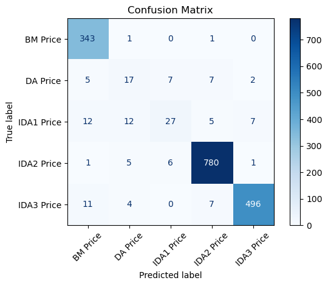
    


```python

#  Get predictions from the model
#  Count predicted labels the get most frequent numeric label and  convert numeric label back to actual market name
predictions = model.predict(X_test)


predicted_counts = pd.Series(predictions).value_counts()


most_common_label = predicted_counts.idxmax()


most_common_market = le.inverse_transform([3])[0]


print("The market most frequently predicted as cheapest by the model is:", most_common_market)

```

    The market most frequently predicted as cheapest by the model is: IDA2 Price
    


```python
# Inverse transform the numeric labels back to their original market names to  count and plot the actual names
df['Best_Market_Name'] = le.inverse_transform(df['Best_Market_Label'])


label_counts = df['Best_Market_Name'].value_counts()

plt.figure(figsize=(8, 6))
plt.pie(label_counts, labels=label_counts.index, autopct='%1.1f%%', startangle=140)
plt.title('Percentage of Time Each Market Was the Cheapest (Apr–Sep 2019)')
plt.axis('equal')
plt.show()

```


    
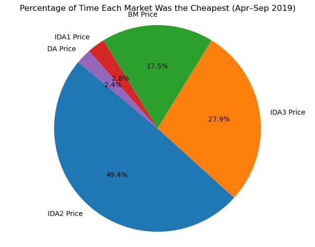
    


```python

```


```python

```


```python

```


```python

```
